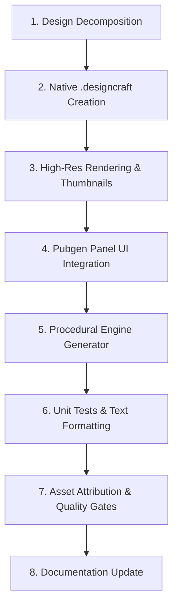

# Creating a New Publication Cover Style from a Reference Design

This guide documents the end-to-end engineering workflow for creating a new publication cover style in DesignCraft's **Pubgen** extension, based on an existing reference image or a native `.designcraft` document (such as `plan/pubgen/samples/style/design-3.designcraft`).

---

## 1. Overview & Architecture

Pubgen's **Publication Cover** generator builds executive, publication-ready covers for BPS/government/corporate annual reports in less than 100ms. All covers are procedurally built using DesignCraft's native command engine (`crates/engine/src/cmd/*`).

### Supported Styles Index Map

| Style Index | UI Pill Label | Full Name | Reference Template |
| :---: | :--- | :--- | :--- |
| `0` | `🌊 Wave` | Wave Curves | Organic dual wave curves with circular photo medallion |
| `1` | `❖ Medallion` | Geometric Medallion | Diagonal planes with concentric gold/navy rings |
| `2` | `◈ Origami` | Folded Origami | Faceted polygonal ribbons with panoramic header |
| `3` | `◆ Chevron` | Chevron & Medallion | Corporate sapphire downward chevron with gold ring |
| `4` | `⬡ Hexagon` | Honeycomb Hexagon | Dark slate background with 12-vertex tri-hexagon cluster |
| `5` | `🏢 Corporate` | Corporate Headline | Modern architecture layout with focal rounded headline block |

---

## 2. Step-by-Step Workflow



---

### Step 1: Design Decomposition & Mathematical Modeling

Before writing code, analyze the reference image and define its geometry, proportions, colors, and typography hierarchy.

1. **Canvas Coordinates**:
   - Standard A4 page: `width = 595.27557 pt`, `height = 841.88975 pt` (or dynamic `pw`, `ph`).
   - Points are measured from top-left `(0, 0)`.

2. **Color Palette Mapping**:
   - **Primary Color** (e.g., `#6c5ce7` / Modern Violet): Used for major headline containers, headers, and framing.
   - **Accent Color** (e.g., `#a29bfe` / Soft Lavender): Used for secondary ribbons, borders, and highlights.
   - **Dark Color** (e.g., `#1e293b` / Slate Charcoal): Used for high-contrast year digits and dark backgrounds.
   - **Base Canvas**: Pure white (`#ffffff`) or dark slate (`#111827`).

3. **Geometric Vectors & Curves**:
   - Decompose curved shapes into SVG path commands (`M`, `L`, `C`, `Z`).
   - For rounded corners on rectangular blocks (e.g., a 46pt radius on top-right corner):
     ```
     M 0 458
     L 294 458
     C 317 458 340 483 340 504
     L 340 680
     L 0 680
     Z
     ```

4. **Typography & Position Lock Hierarchy**:
   - **Position Lock (Universal across all publication styles)**:
     - **Bottom-Left**: Official agency logo graphic frame paired with agency text (`BADAN PUSAT STATISTIK\nKABUPATEN KARAWANG` in **Arial Bold Italic**, 10–12pt).
     - **Top-Right**: Publication catalogue & standard serial number metadata (Line #1: `Katalog BPS: <number>`, Line #2: `ISSN/ISBN <number>` in **Arial Bold**, 8.5pt, right-aligned).
   - **Middle-Left Year & Volume Lockup**: Giant **Arial Black**, 60–68pt (split into dual-tone colors, e.g. `20` dark charcoal, `26` primary purple) with **Volume** (`Volume 23 2026`) directly underneath in **Arial Bold** (11pt) and an accent underline rule.
   - **Main Headline Block**: **Arial Black**, 30–36pt, high-contrast white text (`KECAMATAN\nKARAWANG\nTIMUR\nDALAM ANGKA`).
   - **Clean Architecture**: Remove arbitrary placeholder texts (e.g. "Corporate Design", "Business Report") and decorative icon badges for a clean, professional executive look.

5. **Strict Condition: No Extra Text (Exclusively Options-Derived Text)**:
   A cover style must **never** include hardcoded placeholder, dummy, or extraneous text (e.g., `"Corporate Design"`, `"Business Report"`, `"Annual Report"`, `"Executive Summary"`, `"Company Profile"`, or decorative badge captions).

   Every single text frame created on the cover must originate **strictly and exclusively** from the user-configurable options defined in `PubgenState` / the Publication Cover options panel:
   - **Administrative Level**: `st.cover_level` (`"Kecamatan"` or `"Kabupaten"`).
   - **Publication Title**: `st.cover_title` (e.g. `"KARAWANG TIMUR"`), with the standard official publication suffix `"DALAM ANGKA"`.
   - **Year**: `st.cover_year` (e.g. `"2026"`).
   - **Volume**: `st.cover_volume` (e.g. `"Volume 23 2026"`).
   - **Catalogue**: `st.cover_catalogue` (formatted as `Katalog BPS: <number>`).
   - **Standard Code**: `st.cover_code_type` and `st.cover_code_num` (formatted as `ISSN <number>` or `ISBN <number>`).
   - **Agency / Institution**: `st.cover_agency_text` (e.g. `"BADAN PUSAT STATISTIK\nKABUPATEN KARAWANG"`).

   If a reference design contains decorative text boxes, cards, or badge captions:
   - Retain the geometric shape (e.g., accent card, drop shadow, framing bar) if it contributes to the visual structure.
   - **Omit the text completely** unless it maps to one of the authorized fields above.
   - Never add unconfigurable or synthetic text frames to fill empty canvas areas.

---

### Step 2: Build the Reference `.designcraft` Document

Create a clean, standalone reference file saved in `plan/pubgen/samples/style/design-<N>.designcraft`.

You can construct the document using a scripted headless CLI session:

```bash
# Example: Running script via designcraft-cli
cargo run --release -p designcraft-cli -- script my_cover_script.json
```

Or write a dedicated generator script that runs engine commands:
1. `file.new`: Initialize document.
2. `swatch.create`: Define named CMYK/RGB swatches.
3. `path.create`: Construct background ribbons, top framing strips, and curved blocks.
4. `frame.create`: Place image containers (e.g., vertical skyline photo frame `[221, 168, 565, 780]`).
5. `shadow.set`: Add soft ambient drop shadows to corporate cards.
6. `text.insert` & `text.format`: Populate text stories with exact font families, styles, tracking, and leading.
7. `file.save`: Save output as `plan/pubgen/samples/style/design-<N>.designcraft`.

---

### Step 3: Render High-Resolution Export & UI Thumbnails

1. **Render 300 DPI High-Res Export**:
   ```powershell
   cargo run --release -p designcraft-cli -- run plan/pubgen/samples/style/design-3.designcraft --export outputs/karawang_timur_corporate_cover.png
   ```

2. **Generate UI Thumbnail**:
   Generate or copy the rendered thumbnail to `plan/pubgen/samples/thumb/`:
   ```powershell
   # Target thumbnail size typically ~300x420 px
   Copy-Item "outputs/karawang_timur_corporate_cover.png" "plan/pubgen/samples/thumb/corporate_headline.png"
   ```

---

### Step 4: UI Integration in `pubgen.rs`

Open [`crates/ui-egui/src/panels/pubgen.rs`](file:///f:/GitHub/designcraft/crates/ui-egui/src/panels/pubgen.rs) and register the new style:

#### 1. Dropdown and Pill Declarations
```rust
// Inside card_cover_ui()
let styles = [
    "Wave Curves",
    "Geometric & Medallion",
    "Folded Origami",
    "Chevron & Medallion",
    "Honeycomb Hexagon",
    "Corporate Headline", // Index 5
];

let style_pills: [(&str, usize, &str); 6] = [
    ("🌊 Wave", 0, "Wave Curves"),
    ("❖ Medallion", 1, "Geometric Medallion"),
    ("📐 Origami", 2, "Folded Origami"),
    ("🔰 Chevron", 3, "Chevron & Medallion"),
    ("⬡ Hexagon", 4, "Honeycomb Hexagon"),
    ("🏢 Corporate", 5, "Corporate Headline"),
];
```

#### 2. Theme Preset (Optional but Recommended)
Add a matching color theme preset:
```rust
let themes = [
    "Classic BPS (Blue/Gold)",
    "Emerald & Gold",
    "Crimson & Slate",
    "Modern Teal & Cyan",
    "Modern Violet & Slate", // Preset 4
    "Custom",
];

// Color values on selection:
5 => {
    st.cover_color_primary = "#6c5ce7".into();
    st.cover_color_accent = "#a29bfe".into();
    st.cover_color_dark = "#1e293b".into();
}
```

#### 3. Thumbnail Texture Loader & Tooltip Description
Map the style index to the thumbnail file in `style_thumbnail_texture`:
```rust
fn style_thumbnail_texture(ctx: &egui::Context, style_idx: usize) -> Option<egui::TextureHandle> {
    let (primary, fallback) = match style_idx {
        0 => ("wave_curves.png", "karawang_timur_wave_cover.png"),
        1 => ("geometric_medallion.png", "karawang_timur_medallion_cover.png"),
        2 => ("folded_origami.png", "karawang_timur_origami_cover.png"),
        3 => ("chevron_medallion.png", "karawang_timur_chevron_cover.png"),
        4 => ("karawang_timur_hexagon_cover.png", "honeycomb_hexagon.png"),
        5 => ("corporate_headline.png", "karawang_timur_corporate_cover.png"),
        _ => return None,
    };
    // ...
}
```

Provide the tooltip summary in `show_style_thumbnail_tooltip`:
```rust
5 => "Modern corporate architecture layout with top framing, headline focal block, and position-locked institutional metadata.",
```

#### 4. Procedural Fallback Painter
In `paint_fallback_cover_thumb`, draw the lightweight vector shapes using `egui::Painter` so the thumbnail renders crisply even before the PNG file is loaded:
```rust
_ => {
    // Style 5 (Corporate Headline)
    p.rect_filled(rect, 4.0, Color32::WHITE);
    // Top bar
    let top_bar = egui::Rect::from_min_max(rect.min, rect.min + vec2(w * 0.90, h * 0.025));
    p.rect_filled(top_bar, 0.0, Color32::from_rgb(108, 92, 231));
    // Top-Right Metadata lines (Position Lock)
    let meta_w = w * 0.35;
    p.rect_filled(egui::Rect::from_min_max(rect.max - vec2(meta_w + 6.0, h * 0.965), rect.max - vec2(6.0, h * 0.945)), 1.0, Color32::from_gray(180));
    p.rect_filled(egui::Rect::from_min_max(rect.max - vec2(meta_w + 6.0, h * 0.935), rect.max - vec2(6.0, h * 0.915)), 1.0, Color32::from_gray(180));
    // Middle-left Year & Volume
    p.rect_filled(egui::Rect::from_min_max(rect.min + vec2(w * 0.06, h * 0.32), rect.min + vec2(w * 0.36, h * 0.40)), 2.0, Color32::from_rgb(30, 41, 59));
    p.rect_filled(egui::Rect::from_min_max(rect.min + vec2(w * 0.06, h * 0.41), rect.min + vec2(w * 0.30, h * 0.43)), 1.0, Color32::from_gray(140));
    // Headline block with rounded top-right
    let hl_block = egui::Rect::from_min_max(rect.min + vec2(0.0, h * 0.54), rect.min + vec2(w * 0.58, h * 0.81));
    p.rect_filled(hl_block, egui::CornerRadius { nw: 0, ne: 8, sw: 0, se: 0 }, Color32::from_rgb(108, 92, 231));
    // Bottom-left Agency Logo & Text (Position Lock)
    p.rect_filled(egui::Rect::from_min_max(rect.min + vec2(w * 0.06, h * 0.88), rect.min + vec2(w * 0.14, h * 0.94)), 2.0, Color32::from_rgb(0, 114, 188));
    p.rect_filled(egui::Rect::from_min_max(rect.min + vec2(w * 0.16, h * 0.89), rect.min + vec2(w * 0.50, h * 0.93)), 1.0, Color32::from_gray(80));
}
```

#### 5. Image Pickers
Expose the appropriate image input field in `card_cover_ui`:
```rust
_ => {
    // Style 5: 1 vertical photo
    ui.horizontal(|ui| {
        ui.label(RichText::new("Photo:").size(10.5).color(t.text));
        let w = (ui.available_width() - 65.0).max(80.0);
        ui.add_sized([w, crate::widgets::FIELD_H], egui::TextEdit::singleline(&mut st.cover_image_skyline));
        if ui.add_sized([60.0, crate::widgets::FIELD_H], egui::Button::new("Browse…")).clicked() {
            // ...
        }
    });
}
```

---

### Step 5: Procedural Engine Generator Implementation

In `execute_generate_cover()`, implement the new style arm following the position lock and typography rules:

```rust
5 => {
    // Style 5: Corporate Headline
    // 1. Base white background & top horizontal bar
    app.run("frame.create", json!({"spread": 0, "rect": [0, 0, pw, ph], "content": "unassigned", "shape": "rectangle"}))?;
    app.run("frame.create", json!({"spread": 0, "rect": [0.0, 0.0, 548.0 * sx, 16.0 * sy], "content": "unassigned", "shape": "rectangle"}))?;

    // 2. Top-Right Metadata (Position Lock: Line #1 Catalogue, Line #2 ISSN/ISBN)
    add_cover_text_frame(app, 0, [pw - 260.0 * sx, 24.0 * sy, pw - 36.0 * sx, 42.0 * sy], &cat_text, dark, "Arial", "Bold", 8.5 * s_avg, None, None, "right")?;
    add_cover_text_frame(app, 0, [pw - 260.0 * sx, 42.0 * sy, pw - 36.0 * sx, 60.0 * sy], &code_text, dark, "Arial", "Bold", 8.5 * s_avg, None, None, "right")?;

    // 3. Center-right vertical photo frame + L-bracket framing
    let photo_res = app.run("frame.create", json!({"spread": 0, "rect": [221.0 * sx, 168.0 * sy, 565.0 * sx, 780.0 * sy], "content": "graphic", "shape": "rectangle"}))?;
    // Place image, fit proportionally, apply soft drop shadow...

    // 4. Middle-left Dual-Tone Year & Volume (Volume replacing legacy Business Report)
    let (y1, y2) = if year_text.len() >= 4 { (&year_text[..2], &year_text[2..]) } else { (year_text, "") };
    add_cover_text_frame(app, 0, [36.0 * sx, 260.0 * sy, 118.0 * sx, 335.0 * sy], y1, dark, "Arial Black", "Regular", 62.0 * s_avg, None, Some(10.0), "left")?;
    add_cover_text_frame(app, 0, [116.0 * sx, 260.0 * sy, 215.0 * sx, 335.0 * sy], y2, primary, "Arial Black", "Regular", 62.0 * s_avg, None, Some(10.0), "left")?;
    add_cover_text_frame(app, 0, [36.0 * sx, 340.0 * sy, 220.0 * sx, 360.0 * sy], volume_text, dark, "Arial", "Bold", 11.0 * s_avg, None, Some(25.0), "left")?;

    // Accent underline rule
    app.run("path.create", json!({"spread": 0, "closed": false, "anchors": [{"p": [36.0 * sx, 364.0 * sy]}, {"p": [205.0 * sx, 364.0 * sy]}]}))?;

    // 5. Focal Headline Purple Block with Rounded Bezier Corner
    let r_corner = 46.0 * s_avg;
    app.run("path.create", json!({
        "spread": 0, "closed": true,
        "anchors": [
            {"p": [0.0, 458.0 * sy]},
            {"p": [340.0 * sx - r_corner, 458.0 * sy], "out": [340.0 * sx - r_corner + r_corner * 0.552, 458.0 * sy]},
            {"p": [340.0 * sx, 458.0 * sy + r_corner], "in": [340.0 * sx, 458.0 * sy + r_corner - r_corner * 0.552]},
            {"p": [340.0 * sx, 680.0 * sy]},
            {"p": [0.0, 680.0 * sy]}
        ]
    }))?;
    let _ = app.run("object.color", json!({"color": primary, "target": "fill"}));
    let _ = app.run("object.stroke", json!({"swatch": "[None]"}));
    let _ = app.run("object.opacity", json!({"opacity": 0.85})); // Semi-transparent overlay over the photo
    let _ = app.run("object.dropShadow", json!({"on": true, "distance": 8, "size": 16, "opacity": 0.28}));
    // Headline Typography (Level in Bold, Title in Arial Black, "DALAM ANGKA" in Bold)...

    // 6. Bottom-Left Logo & Agency Text (Position Lock)
    app.run("frame.create", json!({"spread": 0, "rect": [36.0 * sx, 738.0 * sy, 78.0 * sx, 784.0 * sy], "content": "graphic", "shape": "rectangle"}))?;
    // Place logo, center content...
    add_cover_text_frame(app, 0, [86.0 * sx, 742.0 * sy, 360.0 * sx, 786.0 * sy], agency_text, dark, "Arial", "Bold Italic", 10.0 * s_avg, Some(13.5 * s_avg), None, "left")?;
}
```

> [!IMPORTANT]
> **Universal Position Lock & No Extra Text Rules**:
> 1. **Bottom-Left**: Official Agency Logo + Agency Text (`BADAN PUSAT STATISTIK\n...`) in **Arial Bold Italic**.
> 2. **Top-Right**: Publication metadata (Line #1 Catalogue, Line #2 ISSN/ISBN) in **Arial Bold**.
> 3. **Middle-Left**: Volume text directly under the Year numerals with accent underline rule.
> 4. **Strict Condition — No Extra Text**: Strictly **zero** hardcoded dummy, placeholder, or extraneous text boxes. Every single text element must map directly to one of the 7 user-configurable fields in the Publication Cover options panel.

> [!TIP]
> **Preventing Title Hyphenation**: If titles wrap inside a narrow headline box, long words may trigger hyphenation (e.g. `KARAWANG TI- / MUR`). Splitting the title words with newlines (`\n`) guarantees clean lines matching the reference layout.

---

### Step 6: Automated Testing

Update [`crates/ui-egui/src/panels/pubgen.rs`](file:///f:/GitHub/designcraft/crates/ui-egui/src/panels/pubgen.rs) tests:

```rust
#[test]
fn test_execute_generate_cover_text_formatting() {
    for style in 0..=5 { // Include new style
        let mut app = DesignApp::new(designcraft_engine::Session::new(), crate::Services::default());
        app.run("file.new", json!({})).unwrap();
        let mut st = PubgenState::default();
        st.cover_style = style;
        execute_generate_cover(&mut app, &st).unwrap();
        // Assert Arial and Arial Black typography hierarchy...
    }
}
```

Run the unit test:
```powershell
cargo test -p designcraft-ui-egui --features pubgen --lib -- test_execute_generate_cover
```

---

### Step 7: Asset Attribution & Quality Gates

DesignCraft enforces strict clean-room quality gates before any commit:

#### 1. Add Asset Entries to `ASSETS.md`
Every non-code asset (the `.designcraft` file and the thumbnail `.png`) must have a row in [`ASSETS.md`](file:///f:/GitHub/designcraft/ASSETS.md):
```markdown
| `plan/pubgen/samples/style/design-3.designcraft` | DesignCraft contributor (generated) | sample cover design document for Pubgen | CC0-1.0 | Test document |
| `plan/pubgen/samples/thumb/corporate_headline.png` | DesignCraft contributor (generated) | rendered thumbnail for Cover Style 5 (Corporate Headline) | CC0-1.0 | Test thumbnail |
```
Verify with:
```powershell
cargo xtask assets
```

#### 2. Verify Dock Synchronization
Ensure that `dock.rs` and `dock_extended.rs` remain in sync:
```powershell
cargo xtask diff-dock
```

#### 3. Verify Layering
Ensure zero layering violations across all 21 workspace crates:
```powershell
cargo xtask layers
```

#### 4. Run Full Pubgen Test Suite
```powershell
cargo test -p designcraft-ui-egui --features pubgen
```

---

### Step 8: Update User Documentation

1. **English User Guide ([`docs/pubgen-guide.md`](file:///f:/GitHub/designcraft/docs/pubgen-guide.md))**:
   - Update header count (e.g., "The 6 Executive Cover Styles").
   - Add the style section describing visual personality, design elements, and best uses.
   - Add the new quick preview pill (`🏢 Corporate`) to the pills list.
   - Document any new image picker fields.

2. **Indonesian User Guide ([`docs/pubgen-guide_id.md`](file:///f:/GitHub/designcraft/docs/pubgen-guide_id.md))**:
   - Update style count ("6 Gaya Sampul Eksekutif").
   - Add Indonesian translation of style features and recommendations.
   - Update hover thumbnail pills list.

---

## 3. Checklist for Pull Requests

- [ ] Native `.designcraft` sample committed to `plan/pubgen/samples/style/`.
- [ ] UI thumbnail `.png` placed in `plan/pubgen/samples/thumb/`.
- [ ] Style registered in `styles` and `style_pills` in `pubgen.rs`.
- [ ] Fallback vector thumbnail implemented in `paint_fallback_cover_thumb()`.
- [ ] Procedural generation implemented in `execute_generate_cover()`.
- [ ] Universal position lock enforced (Bottom-left logo/agency text in Arial Bold Italic, Top-right catalogue & ISSN/ISBN, Volume under Year).
- [ ] No extra text verified: strictly zero unconfigurable or placeholder text frames (all text originates exclusively from Publication Cover options: level, title, year, volume, catalogue, code, agency).
- [ ] Clean geometry verified (pure architectural shapes without arbitrary icons or badges).
- [ ] Unit tests updated in `pubgen.rs` and passing (`cargo test -p designcraft-ui-egui --features pubgen`).
- [ ] Both `docs/pubgen-guide.md` and `docs/pubgen-guide_id.md` updated.
- [ ] All new asset files attributed in `ASSETS.md` (`cargo xtask assets`).
- [ ] Zero dock drift (`cargo xtask diff-dock`).
- [ ] Zero layering violations (`cargo xtask layers`).
