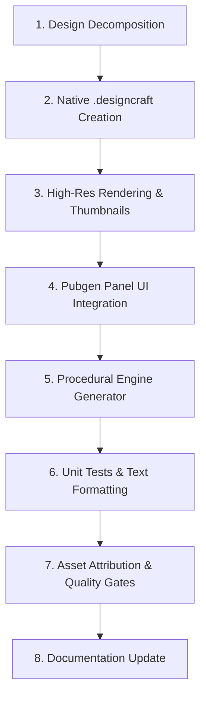

# Creating a New Publication Cover Style from a Reference Design

This guide documents the end-to-end engineering workflow for creating a new publication cover style in DesignCraft's **Pubgen** extension, based on an existing reference image or a native `.designcraft` document (such as `plan/pubgen/samples/style/design-3.designcraft`).

---

## 1. Overview & Architecture

Pubgen's **Publication Cover** generator builds executive, publication-ready covers for BPS/government/corporate annual reports in less than 100ms. All covers are procedurally built using DesignCraft's native command engine (`crates/engine/src/cmd/*`).

### Supported Styles Index Map

| Style Index | UI Pill Label | Full Name | Reference Template |
| :---: | :--- | :--- | :--- |
| `0` | `🌊 Wave` | Wave Curves | Organic dual wave curves with circular photo medallion |
| `1` | `❖ Medallion` | Geometric Medallion | Diagonal planes with concentric gold/navy rings |
| `2` | `◈ Origami` | Folded Origami | Faceted polygonal ribbons with panoramic header |
| `3` | `◆ Chevron` | Chevron & Medallion | Corporate sapphire downward chevron with gold ring |
| `4` | `⬡ Hexagon` | Honeycomb Hexagon | Dark slate background with 12-vertex tri-hexagon cluster |
| `5` | `🏢 Corporate` | Corporate Headline | Modern architecture layout with focal rounded headline block |

---

## 2. Step-by-Step Workflow



---

### Step 1: Design Decomposition & Mathematical Modeling

Before writing code, analyze the reference image and define its geometry, proportions, colors, and typography hierarchy.

1. **Canvas Coordinates**:
   - Standard A4 page: `width = 595.27557 pt`, `height = 841.88975 pt` (or dynamic `pw`, `ph`).
   - Points are measured from top-left `(0, 0)`.

2. **Color Palette Mapping**:
   - **Primary Color** (e.g., `#6c5ce7` / Modern Violet): Used for major headline containers, headers, and framing.
   - **Accent Color** (e.g., `#a29bfe` / Soft Lavender): Used for secondary ribbons, borders, and highlights.
   - **Dark Color** (e.g., `#1e293b` / Slate Charcoal): Used for high-contrast year digits and dark backgrounds.
   - **Base Canvas**: Pure white (`#ffffff`) or dark slate (`#111827`).

3. **Geometric Vectors & Curves**:
   - Decompose curved shapes into SVG path commands (`M`, `L`, `C`, `Z`).
   - For rounded corners on rectangular blocks (e.g., a 46pt radius on top-right corner):
     ```
     M 0 458
     L 294 458
     C 317 458 340 483 340 504
     L 340 680
     L 0 680
     Z
     ```

4. **Typography Hierarchy**:
   - **Agency / Institution**: **Arial Bold Italic**, 10–12pt.
   - **Year Display**: Giant **Arial Black**, 60–68pt (optionally split into dual-tone colors).
   - **Report Subtitle**: **Arial Bold**, 12pt, uppercase, with 2–3pt accent underline rule.
   - **Main Title**: **Arial Black**, 30–36pt, high-contrast white.
   - **Badges & Metadata**: 8.5–9.5pt crisp metadata labels.

---

### Step 2: Build the Reference `.designcraft` Document

Create a clean, standalone reference file saved in `plan/pubgen/samples/style/design-<N>.designcraft`.

You can construct the document using a scripted headless CLI session:

```bash
# Example: Running script via designcraft-cli
cargo run --release -p designcraft-cli -- script my_cover_script.json
```

Or write a dedicated generator script that runs engine commands:
1. `file.new`: Initialize document.
2. `swatch.create`: Define named CMYK/RGB swatches.
3. `path.create`: Construct background ribbons, top framing strips, and curved blocks.
4. `frame.create`: Place image containers (e.g., vertical skyline photo frame `[221, 168, 565, 780]`).
5. `shadow.set`: Add soft ambient drop shadows to corporate cards.
6. `text.insert` & `text.format`: Populate text stories with exact font families, styles, tracking, and leading.
7. `file.save`: Save output as `plan/pubgen/samples/style/design-<N>.designcraft`.

---

### Step 3: Render High-Resolution Export & UI Thumbnails

1. **Render 300 DPI High-Res Export**:
   ```powershell
   cargo run --release -p designcraft-cli -- run plan/pubgen/samples/style/design-3.designcraft --export outputs/karawang_timur_corporate_cover.png
   ```

2. **Generate UI Thumbnail**:
   Generate or copy the rendered thumbnail to `plan/pubgen/samples/thumb/`:
   ```powershell
   # Target thumbnail size typically ~300x420 px
   Copy-Item "outputs/karawang_timur_corporate_cover.png" "plan/pubgen/samples/thumb/corporate_headline.png"
   ```

---

### Step 4: UI Integration in `pubgen.rs`

Open [`crates/ui-egui/src/panels/pubgen.rs`](file:///f:/GitHub/designcraft/crates/ui-egui/src/panels/pubgen.rs) and register the new style:

#### 1. Dropdown and Pill Declarations
```rust
// Inside card_cover_ui()
let styles = [
    "Wave Curves",
    "Geometric & Medallion",
    "Folded Origami",
    "Chevron & Medallion",
    "Honeycomb Hexagon",
    "Corporate Headline", // Index 5
];

let style_pills: [(&str, usize, &str); 6] = [
    ("🌊 Wave", 0, "Wave Curves"),
    ("❖ Medallion", 1, "Geometric Medallion"),
    ("📐 Origami", 2, "Folded Origami"),
    ("🔰 Chevron", 3, "Chevron & Medallion"),
    ("⬡ Hexagon", 4, "Honeycomb Hexagon"),
    ("🏢 Corporate", 5, "Corporate Headline"),
];
```

#### 2. Theme Preset (Optional but Recommended)
Add a matching color theme preset:
```rust
let themes = [
    "Classic BPS (Blue/Gold)",
    "Emerald & Gold",
    "Crimson & Slate",
    "Modern Teal & Cyan",
    "Modern Violet & Slate", // Preset 4
    "Custom",
];

// Color values on selection:
5 => {
    st.cover_color_primary = "#6c5ce7".into();
    st.cover_color_accent = "#a29bfe".into();
    st.cover_color_dark = "#1e293b".into();
}
```

#### 3. Thumbnail Texture Loader & Tooltip Description
Map the style index to the thumbnail file in `style_thumbnail_texture`:
```rust
fn style_thumbnail_texture(ctx: &egui::Context, style_idx: usize) -> Option<egui::TextureHandle> {
    let (primary, fallback) = match style_idx {
        0 => ("wave_curves.png", "karawang_timur_wave_cover.png"),
        1 => ("geometric_medallion.png", "karawang_timur_medallion_cover.png"),
        2 => ("folded_origami.png", "karawang_timur_origami_cover.png"),
        3 => ("chevron_medallion.png", "karawang_timur_chevron_cover.png"),
        4 => ("karawang_timur_hexagon_cover.png", "honeycomb_hexagon.png"),
        5 => ("corporate_headline.png", "karawang_timur_corporate_cover.png"),
        _ => return None,
    };
    // ...
}
```

Provide the tooltip summary in `show_style_thumbnail_tooltip`:
```rust
5 => "Modern corporate architecture layout with top framing, headline focal block, and feature badges.",
```

#### 4. Procedural Fallback Painter
In `paint_fallback_cover_thumb`, draw the lightweight vector shapes using `egui::Painter` so the thumbnail renders crisply even before the PNG file is loaded:
```rust
_ => {
    // Style 5 (Corporate Headline)
    p.rect_filled(rect, 4.0, Color32::WHITE);
    // Top bar
    let top_bar = egui::Rect::from_min_max(rect.min, rect.min + vec2(w * 0.90, h * 0.025));
    p.rect_filled(top_bar, 0.0, Color32::from_rgb(108, 92, 231));
    // Headline block with rounded top-right
    let hl_block = egui::Rect::from_min_max(rect.min + vec2(0.0, h * 0.54), rect.min + vec2(w * 0.58, h * 0.81));
    p.rect_filled(hl_block, egui::CornerRadius { nw: 0, ne: 8, sw: 0, se: 0 }, Color32::from_rgb(108, 92, 231));
}
```

#### 5. Image Pickers
Expose the appropriate image input field in `card_cover_ui`:
```rust
_ => {
    // Style 5: 1 vertical photo
    ui.horizontal(|ui| {
        ui.label(RichText::new("Photo:").size(10.5).color(t.text));
        let w = (ui.available_width() - 65.0).max(80.0);
        ui.add_sized([w, crate::widgets::FIELD_H], egui::TextEdit::singleline(&mut st.cover_image_skyline));
        if ui.add_sized([60.0, crate::widgets::FIELD_H], egui::Button::new("Browse…")).clicked() {
            // ...
        }
    });
}
```

---

### Step 5: Procedural Engine Generator Implementation

In `execute_generate_cover()`, implement the new style arm:

```rust
5 => {
    // Style 5: Corporate Headline
    // 1. Top horizontal bar
    app.run("path.create", json!({
        "d": format!("M 0 0 L {} 0 L {} {} L 0 {} Z", pw * 0.89, pw * 0.89, ph * 0.026, ph * 0.026),
        "fill": st.cover_color_primary,
    }))?;

    // 2. Photo frame + L-bracket
    let frame_res = app.run("frame.create", json!({
        "rect": [pw * 0.37, ph * 0.20, pw * 0.95, ph * 0.92],
    }))?;
    // Fit photo if available...

    // 3. Focal Headline Block with Rounded Corner
    let r = 46.0;
    let d_headline = format!(
        "M 0 {} L {} {} C {} {} {} {} {} {} L {} {} L 0 {} Z",
        ph * 0.54,
        pw * 0.57 - r, ph * 0.54,
        pw * 0.57 - r/2.0, ph * 0.54, pw * 0.57, ph * 0.54 + r/2.0, pw * 0.57, ph * 0.54 + r,
        pw * 0.57, ph * 0.81,
        ph * 0.81
    );
    app.run("path.create", json!({
        "d": d_headline,
        "fill": st.cover_color_primary,
    }))?;

    // 4. Headline Typography (Formatted with Arial Black)
    // IMPORTANT: Insert line breaks in long titles to prevent unwanted hyphenation:
    let formatted_title = st.cover_title.trim().replace(' ', "\n");
    // Insert text and format...

    // 5. Dual-Tone Year Display
    // Split "2026" into "20" (#1e293b) and "26" (#6c5ce7)
    // ...

    // 6. Vector Feature Badges
    // Draw circle frame + vector icon paths (trend line, target, globe)
    // ...
}
```

> [!IMPORTANT]
> **Avoid Emojis for Badges**: Arial renders unicode symbols like 📈, 🎯, 🌐 as missing glyph tofu (`▯`). Always render badge icons using native vector paths (`path.create`) or circle primitives for 100% platform-independent rendering.

> [!TIP]
> **Preventing Title Hyphenation**: If titles wrap inside a narrow headline box, long words may trigger hyphenation (e.g. `KARAWANG TI- / MUR`). Splitting the title words with newlines (`\n`) guarantees clean lines matching the reference layout.

---

### Step 6: Automated Testing

Update [`crates/ui-egui/src/panels/pubgen.rs`](file:///f:/GitHub/designcraft/crates/ui-egui/src/panels/pubgen.rs) tests:

```rust
#[test]
fn test_execute_generate_cover_text_formatting() {
    for style in 0..=5 { // Include new style
        let mut app = DesignApp::new(designcraft_engine::Session::new(), crate::Services::default());
        app.run("file.new", json!({})).unwrap();
        let mut st = PubgenState::default();
        st.cover_style = style;
        execute_generate_cover(&mut app, &st).unwrap();
        // Assert Arial and Arial Black typography hierarchy...
    }
}
```

Run the unit test:
```powershell
cargo test -p designcraft-ui-egui --features pubgen --lib -- test_execute_generate_cover
```

---

### Step 7: Asset Attribution & Quality Gates

DesignCraft enforces strict clean-room quality gates before any commit:

#### 1. Add Asset Entries to `ASSETS.md`
Every non-code asset (the `.designcraft` file and the thumbnail `.png`) must have a row in [`ASSETS.md`](file:///f:/GitHub/designcraft/ASSETS.md):
```markdown
| `plan/pubgen/samples/style/design-3.designcraft` | DesignCraft contributor (generated) | sample cover design document for Pubgen | CC0-1.0 | Test document |
| `plan/pubgen/samples/thumb/corporate_headline.png` | DesignCraft contributor (generated) | rendered thumbnail for Cover Style 5 (Corporate Headline) | CC0-1.0 | Test thumbnail |
```
Verify with:
```powershell
cargo xtask assets
```

#### 2. Verify Dock Synchronization
Ensure that `dock.rs` and `dock_extended.rs` remain in sync:
```powershell
cargo xtask diff-dock
```

#### 3. Verify Layering
Ensure zero layering violations across all 21 workspace crates:
```powershell
cargo xtask layers
```

#### 4. Run Full Pubgen Test Suite
```powershell
cargo test -p designcraft-ui-egui --features pubgen
```

---

### Step 8: Update User Documentation

1. **English User Guide ([`docs/pubgen-guide.md`](file:///f:/GitHub/designcraft/docs/pubgen-guide.md))**:
   - Update header count (e.g., "The 6 Executive Cover Styles").
   - Add the style section describing visual personality, design elements, and best uses.
   - Add the new quick preview pill (`🏢 Corporate`) to the pills list.
   - Document any new image picker fields.

2. **Indonesian User Guide ([`docs/pubgen-guide_id.md`](file:///f:/GitHub/designcraft/docs/pubgen-guide_id.md))**:
   - Update style count ("6 Gaya Sampul Eksekutif").
   - Add Indonesian translation of style features and recommendations.
   - Update hover thumbnail pills list.

---

## 3. Checklist for Pull Requests

- [ ] Native `.designcraft` sample committed to `plan/pubgen/samples/style/`.
- [ ] UI thumbnail `.png` placed in `plan/pubgen/samples/thumb/`.
- [ ] Style registered in `styles` and `style_pills` in `pubgen.rs`.
- [ ] Fallback vector thumbnail implemented in `paint_fallback_cover_thumb()`.
- [ ] Procedural generation implemented in `execute_generate_cover()`.
- [ ] Vector icons used for badges (no emoji characters).
- [ ] Unit tests updated in `pubgen.rs` and passing (`cargo test -p designcraft-ui-egui --features pubgen`).
- [ ] Both `docs/pubgen-guide.md` and `docs/pubgen-guide_id.md` updated.
- [ ] All new asset files attributed in `ASSETS.md` (`cargo xtask assets`).
- [ ] Zero dock drift (`cargo xtask diff-dock`).
- [ ] Zero layering violations (`cargo xtask layers`).
