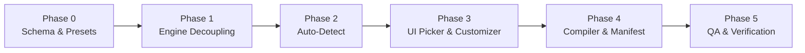

# PubGen Pillar 7 — Universal Publication Profiles & General-Purpose Extensibility Mini-Plan

- **Document:** `docs/plans/2026-10-30-pubgen-pillar7-universal-profiles-mini-plan.md`
- **Date:** 2026-10-30
- **Status:** Draft — not started. M7 of [`2026-10-25-pubgen-future-roadmap-and-extension-plan.md`](2026-10-25-pubgen-future-roadmap-and-extension-plan.md) (Pillar 7)
- **Branch:** `feature/pillar7-universal-profiles` (proposed, off `pubgen-0.7.X`)
- **Target:** `crates/ui-egui/src/panels/pubgen/`, `assets/pubgen/profiles/`, `crates/engine/src/cmd/`, `docs/plans/`

---

## 1. Goal

Transform PubGen from a single-agency municipal layout compiler (*Daerah Dalam Angka* / *Kecamatan Dalam Angka* - DDA/KCDA) into a **Universal Publication Engine** capable of generating both:
1. **Diverse BPS Publications:** DDA/KCDA, Berita Resmi Statistik (BRS), Analisis Tematik / Indikator Makro, and Buku Saku Statistik (Pocketbooks).
2. **General-Purpose & Enterprise Publications:** Corporate Annual Reports, Local Government Performance Reports (LAKIP/LPPD), Academic/Think Tank Monographs, and Technical Specification Catalogs.

This is achieved **without rewriting the core engine** by decoupling layout and nomenclature rules into a declarative **`PubgenProfile`** specification, supported by smart sheet auto-detection, a visual UI profile switcher, and interactive quick-customization.

---

## 2. Current State & Hardcoded Couplings (Verified 2026-10-30)

| Area | Current Implementation | Files & Lines | Limitation / Coupling |
| :--- | :--- | :--- | :--- |
| **Sheet Routing** | Strict prefix matching (`C01..`, `DIV`, `R01..`, `01_01..`) | `excel.rs:159-167` (`is_table_sheet_name`), `excel.rs:882` (`is_chart_sheet`), `excel.rs:1186` (`is_divider_sheet`), `helpers.rs:605` (`is_ulasan_type`) | Non-DDA workbooks (e.g., sheets named `Tabel_1`, `Financials`, `Ringkasan`, `Grafik`) are completely ignored or misclassified. |
| **Nomenclature** | Hardcoded Indonesian / English keywords | `locale.rs:1-343`, `excel.rs:630-651` (`matches_table_note_keyword`) | Titles require `"Tabel"`, `"BAB"`, `"Grafik"`. Note rows strictly search for `Sumber:` / `Catatan:`. Cannot adapt to `"Section"`, `"Figure"`, `"Exhibit"`, or `"Reference"`. |
| **Table Numbering Row** | Injected row `(1) (2) (3) ... (N)` under headers | `tables.rs:250-280`, `tables.rs:620-650` | Mandatory in BPS DDA tables, but looks unprofessional and unwanted in corporate annual reports, policy briefs, and academic monographs. |
| **Document Geometry** | Fixed BPS margins: Top 20.2 mm, Bottom 20 mm, Inside 19 mm, Outside 15 mm | `compile.rs:240-260`, `pages.rs:120-145` | Cannot naturally emit single-page BRS press releases (margins 15 mm all around) or academic papers with wide outer margin annotations (30 mm). |
| **Document Flow** | Hardcoded sequence: Cover → Front Matter (Roman) → Chapters (Arabic) → Back Cover | `compile.rs:1100-1160` (`execute_compile_project`) | Publications without Roman front matter or without chapter dividers (e.g. 8-page BRS or 20-page whitepapers) cannot be expressed cleanly. |

---

## 3. Core Architecture: The 3-Layer Decoupling

```text
┌────────────────────────────────────────────────────────────────────────┐
│                        LAYER 1: CORE ENGINE                            │
│  • Matrix & CSV Parser        • Vector Chart Generator (Pillar 1)      │
│  • Flow Layout & Paragraphs   • Preflight Audit Rules (Pillar 3)       │
│  • Synchronized Multi-pass TOC • AI Translation & Summarizer (Pillar 4) │
└───────────────────────────────────┬────────────────────────────────────┘
                                    │ consumes
                                    ▼
┌────────────────────────────────────────────────────────────────────────┐
│                   LAYER 2: UNIVERSAL PAGE ARCHETYPES                   │
│  [A. Display Spread]   [B. Tabular Matrix]   [C. Editorial Narrative]  │
│  [D. Infographic/KPI]  [E. Reference/TOC]                              │
└───────────────────────────────────┬────────────────────────────────────┘
                                    │ parameterized by
                                    ▼
┌────────────────────────────────────────────────────────────────────────┐
│             LAYER 3: PUBLICATION PROFILE (`PubgenProfile`)             │
│  • Geometry & Margins         • Sheet Routing Regex                    │
│  • Typography & Palettes      • Structural Flow Sequence               │
│  • Nomenclature & Keywords    • Table Styling Flags (e.g. numbering row)│
└────────────────────────────────────────────────────────────────────────┘
```

---

## 4. `PubgenProfile` Schema Specification

The configuration model will be serialized as JSON/TOML under `assets/pubgen/profiles/<profile_id>.json`:

```rust
#[derive(Clone, Debug, Serialize, Deserialize, PartialEq)]
pub struct PubgenProfile {
    pub id: String,
    pub name: String,
    pub description: String,
    pub sector: ProfileSector,
    pub geometry: ProfileGeometry,
    pub structure: ProfileStructure,
    pub nomenclature: ProfileNomenclature,
    pub sheet_routing: ProfileSheetRouting,
    pub table_styling: ProfileTableStyling,
}

#[derive(Clone, Debug, Serialize, Deserialize, PartialEq)]
pub enum ProfileSector {
    BpsOfficial,
    Government,
    Corporate,
    Academic,
    Custom,
}

#[derive(Clone, Debug, Serialize, Deserialize, PartialEq)]
pub struct ProfileGeometry {
    pub page_size: String,          // "A4", "B5", "A5", "Letter"
    pub facing_pages: bool,         // true = facing spreads with spine/gutter; false = single page
    pub margins_mm: MarginsMm,
}

#[derive(Clone, Debug, Serialize, Deserialize, PartialEq)]
pub struct MarginsMm {
    pub top: f64,
    pub bottom: f64,
    pub inside: f64,                // Or Left for single pages
    pub outside: f64,               // Or Right for single pages
}

#[derive(Clone, Debug, Serialize, Deserialize, PartialEq)]
pub struct ProfileStructure {
    pub has_front_matter: bool,     // e.g. Kata Pengantar, Daftar Isi
    pub front_matter_numbering: String, // "roman_lower", "arabic", "none"
    pub restart_body_numbering: bool,
    pub require_chapter_dividers: bool,
    pub include_inside_cover: bool,
    pub include_back_cover: bool,
}

#[derive(Clone, Debug, Serialize, Deserialize, PartialEq)]
pub struct ProfileNomenclature {
    pub chapter_prefix: String,     // "BAB", "Bagian", "Section", or ""
    pub table_prefix: String,       // "Tabel", "Table"
    pub chart_prefix: String,       // "Grafik", "Chart", "Figure"
    pub toc_title: String,          // "Daftar Isi", "Table of Contents"
    pub list_tables_title: String,  // "Daftar Tabel", "List of Tables"
    pub list_charts_title: String,  // "Daftar Grafik", "List of Figures"
    pub source_labels: Vec<String>, // ["Sumber:", "Source:", "Data:"]
    pub note_labels: Vec<String>,   // ["Catatan:", "Note:", "Notes:"]
}

#[derive(Clone, Debug, Serialize, Deserialize, PartialEq)]
pub struct ProfileSheetRouting {
    pub cover_patterns: Vec<String>,     // Regex patterns, e.g. ["(?i)^cover$", "(?i)^sampul$"]
    pub divider_patterns: Vec<String>,   // ["(?i)^div.*", "(?i)^section.*", "(?i)^pembatas.*"]
    pub narrative_patterns: Vec<String>, // ["(?i)^r\\d+.*", "(?i)^ulasan.*", "(?i)^narrative.*"]
    pub table_patterns: Vec<String>,     // ["(?i)^\\d+[_.]\\d+.*", "(?i)^tabel.*", "(?i)^table.*"]
    pub chart_patterns: Vec<String>,     // ["(?i)^c\\d+.*", "(?i)^chart.*", "(?i)^grafik.*"]
}

#[derive(Clone, Debug, Serialize, Deserialize, PartialEq)]
pub struct ProfileTableStyling {
    pub include_column_number_row: bool, // (1) (2) (3) row
    pub alternating_row_fills: bool,     // Zebra striping
    pub horizontal_rules_only: bool,     // Minimalist / APA style (no vertical rules)
    pub default_theme_palette: String,   // "bps_teal", "corporate_navy", "monochrome"
}
```

---

## 5. Built-in Out-of-the-Box Profiles

| Profile ID | Target Publications | Page / Facing | Margins (T/B/I/O) | Col # Row | Table Style |
| :--- | :--- | :--- | :--- | :--- | :--- |
| **`bps_dda`** *(Default)* | BPS Daerah/Kecamatan Dalam Angka | A4/B5 Facing | 20.2 / 20 / 19 / 15 mm | **Yes** `(1)(2)(3)` | Full grid + theme headers |
| **`bps_brs`** | BPS Berita Resmi Statistik (Press Release) | A4 Single Page | 18 / 18 / 18 / 18 mm | **No** | Modern compact, 2-column text |
| **`corporate_annual`** | Corporate & BUMD Annual/Quarterly Reports | A4 Facing | 25 / 25 / 22 / 18 mm | **No** | Minimalist rules, spacious padding |
| **`academic_monograph`** | Research Papers, Policy Briefs, LPPD | A4 Facing | 25 / 25 / 25 / 20 mm | **No** | Academic 3-rule tables (APA/Chicago) |

---

## 6. User Experience & Profile Selection Strategy

To ensure zero friction for routine BPS operators while granting total flexibility for enterprise users, selection operates on **4 interactive tiers**:

```text
┌────────────────────────────────────────────────────────────────────────┐
│ [Smart Ingestion] -> [Auto-Detect Badge] -> [Visual Picker / Override] │
│                                           -> [Quick Customizer Pop-up] │
└────────────────────────────────────────────────────────────────────────┘
```

### 6.1 Tier 1: Smart Auto-Detection (Zero-Click Default)
When the user drags and drops or browses an `.xlsx` workbook:
1. PubGen inspects sheet names in memory.
2. If sheets match `DIV`, `R01`, and `01_01` → sets profile to **`bps_dda`**.
3. If sheets match `BRS_UTAMA`, `RINGKASAN_EKSEKUTIF`, or `GRAFIK_UTAMA` → sets profile to **`bps_brs`**.
4. If sheets contain arbitrary names like `BalanceSheet`, `Income_Statement`, `Summary` → sets profile to **`corporate_annual`**.
5. Displays a subtle status pill in the UI:
   `[⚡ Auto-detected: BPS Daerah Dalam Angka (Ubah ▼)]`

### 6.2 Tier 2: Visual Profile Picker in Header
Placed at the top of the PubGen panel:
- A combobox dropdown grouped by sector (*BPS Official*, *Umum & Korporat*, *Kustom*).
- Under the dropdown, a 1-line metadata preview:
  `Format: A4 Facing Pages • Margin: 20/20/19/15 mm • Nomor Kolom Tabel: Aktif`

### 6.3 Tier 3: Interactive "Customize Profile..." Dialog
Next to the profile selector, a `[⚙ Sesuaikan...]` button opens an egui modal dialog allowing instant overrides:
- **Geometry:** Dropdowns for Page Size (`A4`, `B5`, `A5`, `Letter`) and Spread Mode (`Facing Pages` vs `Single Page`).
- **Margins:** Numeric inputs with millimeter units (`Top`, `Bottom`, `Inside`, `Outside`).
- **Table Formatting Toggles:**
  - `[x] Tampilkan baris penomoran kolom (1) (2) (3)`
  - `[ ] Hanya garis horizontal (Minimalist / Tanpa garis vertikal)`
- **Nomenclature Overrides:** Text fields for `Label Bab` (default: "BAB"), `Label Tabel`, `Label Grafik`.
- **Actions:** `[Terapkan Sesi Ini]` or `[Simpan sebagai Profil Kustom...]`.

### 6.4 Tier 4: Batch / Manifest Integration (`pubgen_project.json`)
For automated compilation and CI pipelines, the project manifest declares the profile explicitly:
```json
{
  "publication_title": "Kabupaten Bekasi Dalam Angka 2026",
  "profile": "bps_dda",
  "chapters": [...]
}
```
If `"profile"` is omitted, it defaults to `"bps_dda"` to preserve 100% backward compatibility.

---

## 7. Phased Implementation Roadmap



### Phase 0: Profile Schema & Asset Presets
- Create `crates/ui-egui/src/panels/pubgen/profiles.rs` defining `PubgenProfile` and sub-structs with `serde`.
- Place bundled JSON presets in `assets/pubgen/profiles/`:
  - `bps_dda.json`
  - `bps_brs.json`
  - `corporate_annual.json`
  - `academic_monograph.json`
- Implement `ProfileManager`: loads bundled profiles with fallback, scans user custom profiles directory.

### Phase 1: Parameterize Engine Sheet Routing & Table Styling
- Update `excel.rs`:
  - Modify `is_table_sheet_name`, `is_chart_sheet`, and `is_divider_sheet` to test against the active `ProfileSheetRouting` regexes.
  - Retain DDA constants as fast-path fallbacks.
- Update `tables.rs`:
  - Gate the insertion of the `(1) (2) (3)` column numbering row behind `profile.table_styling.include_column_number_row`.
  - Support `profile.table_styling.horizontal_rules_only` to suppress vertical borders for corporate/academic styles.
- Update `locale.rs`:
  - Resolve chapter/table/chart prefixes and note keywords from `profile.nomenclature`.

### Phase 2: Ingestion & Smart Auto-Detection
- Implement `detect_profile_from_sheets(sheet_names: &[String]) -> &'static str` in `excel.rs`.
- When an Excel file is loaded via Card 1 or drag-and-drop, run auto-detection:
  - If user hasn't explicitly locked a profile, apply the detected profile.

### Phase 3: UI Header Switcher & Customization Dialog
- Update `widgets.rs` / `pubgen_dialogs.rs`:
  - Render profile combobox in the PubGen panel header.
  - Implement modal `Customize Profile Dialog` with live field validation (positive non-zero margins, valid regexes).
  - Add `Export Profile (*.json)` and `Import Profile (*.json)` using native file picker.

### Phase 4: Publication Compiler & Manifest Support
- Update `compile.rs` (`pubgen.compileProject`):
  - Read optional `"profile"` property from `pubgen_project.json`.
  - Apply profile's margins, facing pages setting, and front-matter rules dynamically during master spread creation.

### Phase 5: Verification, Regressions, & Documentation
- Write unit tests covering:
  - Sheet routing regex evaluation across all built-in profiles.
  - Table generation without column numbers under `corporate_annual`.
  - Single-page margins generation under `bps_brs`.
  - Strict regression test ensuring `bps_dda` output is byte-for-byte identical to pre-refactor output.
- Update `docs/target-app-parity.md` and `ROADMAP.md`.

---

## 8. Verification & Quality Gates

Every step follows the non-negotiable repository guidelines:
1. **Never Crash:**
   - Any malformed, missing, or corrupt profile JSON must degrade safely to `bps_dda` with a visible warning, never panicking.
   - Profile margins and dimensions must be sanity-checked (`min 5 mm`, `max 100 mm`).
2. **Quality Gates:**
   - `cargo xtask ci` must pass with zero clippy warnings.
   - Run `cargo test -p designcraft-ui-egui --features pubgen` across all test suites.
3. **Clean-room & Independence:**
   - No external styling dependencies or Adobe presets used. All profile definitions are clean-room open formats.

---

## 9. Conclusion

Implementing **Pillar 7 (Universal Publication Profiles)** unlocks infinite publishing flexibility for DesignCraft. By separating the mechanical layout logic from document design specifications, PubGen transforms into an adaptable enterprise publishing powerhouse while retaining 100% of its hardened BPS DDA automation capabilities.

