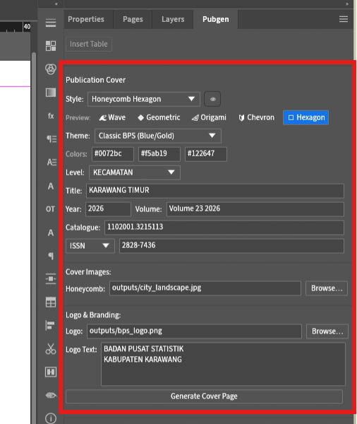
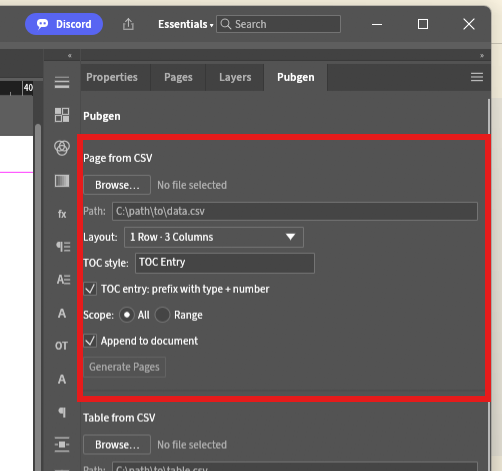
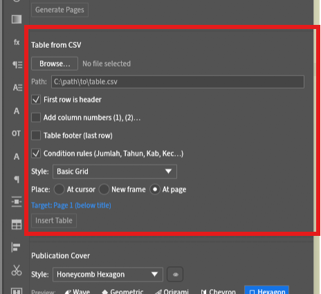

# Pubgen: Generator Publikasi Otomatis — Panduan Lengkap Pengguna

> **Selamat datang di Pubgen!** Panduan ini disusun khusus untuk penyusun publikasi, staf statistik, desainer tata letak, dan pengelola dokumen kelembagaan (seperti BPS dan instansi pemerintah/swasta). Seluruh fitur, opsi, dan alur kerja di menu **Pubgen** dijelaskan secara rinci dengan bahasa yang mudah dipahami oleh pengguna umum.

---

## Daftar Isi
1. [Apa itu Pubgen?](#1-apa-itu-pubgen)
2. [Menemukan Pubgen di DesignCraft](#2-menemukan-pubgen-di-designcraft)
3. [Bagian 1: Publication Cover (Pembuat Halaman Sampul Otomatis)](#3-bagian-1-publication-cover-pembuat-halaman-sampul-otomatis)
   - [Ikhtisar & Posisi Halaman](#ikhtisar--posisi-halaman)
   - [13 Gaya Sampul Eksekutif](#13-gaya-sampul-eksekutif)
   - [Pratinjau Thumbnail Hover](#pratinjau-thumbnail-hover)
   - [Tema Warna & Kustomisasi Palet](#tema-warna--kustomisasi-palet)
   - [Metadata & Isian Informasi Publikasi](#metadata--isian-informasi-publikasi)
   - [Pemilih Gambar Kustom & Logo](#pemilih-gambar-kustom--logo)
   - [Membuat Halaman Sampul](#membuat-halaman-sampul)
4. [Bagian 2: Page from CSV / Excel (Otomasi Pembuatan Halaman & Bab)](#4-bagian-2-page-from-csv--excel-otomasi-pembuatan-halaman--bab)
   - [Cara Kerja](#cara-kerja)
   - [Format Berkas Input (CSV & Excel)](#format-berkas-input-csv--excel)
   - [Pemetaan Kolom (Type, Number, Title)](#pemetaan-kolom-type-number-title)
   - [Preset Tata Letak (Layout Presets)](#preset-tata-letak-layout-presets)
   - [Cakupan Data & Penempatan Halaman](#cakupan-data--penempatan-halaman)
   - [Menyisipkan Tabel Otomatis dari Kolom 'file'](#menyisipkan-tabel-otomatis-dari-kolom-file)
5. [Bagian 3: Table from CSV / Excel (Pembuat Tabel Statistik Siap Cetak)](#5-bagian-3-table-from-csv--excel-pembuat-tabel-statistik-siap-cetak)
   - [Cara Kerja](#cara-kerja-1)
   - [Opsi Header & Header Bertingkat (Stacked Headers)](#opsi-header--header-bertingkat-stacked-headers)
   - [Baris Nomor Kolom: (1), (2), (3)...](#baris-nomor-kolom-1-2-3)
   - [Baris Footer Tabel & Catatan Sumber Otomatis](#baris-footer-tabel--catatan-sumber-otomatis)
   - [Aturan Kondisi (Condition Rules: Penyorotan Otomatis Baris Jumlah/Total)](#aturan-kondisi-condition-rules-penyorotan-otomatis-baris-jumlahtotal)
   - [Gaya Garis Tabel (Booktabs Horizontal, Navy, Grid)](#gaya-garis-tabel)
   - [Mode Penempatan Tabel (At Page, New Frame, At Cursor)](#mode-penempatan-tabel)
   - [Berkas Excel Multi-Sheet & Ekspor Arsip ZIP](#berkas-excel-multi-sheet--ekspor-arsip-zip)
6. [Bagian 4: Utilitas Halaman & Tata Letak](#6-bagian-4-utilitas-halaman--tata-letak)
   - [Sakelar Halaman Tunggal vs Halaman Ganda (Facing Pages)](#sakelar-halaman-tunggal-vs-halaman-ganda-facing-pages)
   - [Menambah Halaman Kosong (Add Blank Page)](#menambah-halaman-kosong-add-blank-page)
   - [Daftar Isi Otomatis (Add TOC / Rebuild TOC)](#daftar-isi-otomatis-add-toc--rebuild-toc)
   - [Impor Cerita Teks RTF (Page from RTF)](#impor-cerita-teks-rtf-page-from-rtf)
   - [Menyisipkan Gambar (Page from Image: Objek vs Latar Belakang Penuh)](#menyisipkan-gambar-page-from-image-objek-vs-latar-belakang-penuh)
   - [Penomoran Ulang Halaman & Seksi (Romawi vs Arab)](#penomoran-ulang-halaman--seksi-romawi-vs-arab)
7. [Tutorial Praktis Langkah demi Langkah](#7-tutorial-praktis-langkah-demi-langkah)
   - [Tutorial 1: Menyusun Publikasi Lengkap dalam 3 Menit](#tutorial-1-menyusun-publikasi-lengkap-dalam-3-menit)
   - [Tutorial 2: Mendesain Sampul Kustom dengan Foto & Warna Sendiri](#tutorial-2-mendesain-sampul-kustom-dengan-foto--warna-sendiri)
   - [Tutorial 3: Memformat Tabel Statistik Kompleks dari Excel](#tutorial-3-memformat-tabel-statistik-kompleks-dari-excel)
8. [Tanya Jawab (FAQ) & Panduan Mengatasi Kendala](#8-tanya-jawab-faq--panduan-mengatasi-kendala)

---

## 1. Apa itu Pubgen?

**Pubgen** (*Publication Generator*) adalah modul otomasi tata letak yang terpasang langsung di dalam DesignCraft.

Dalam aplikasi tata letak konvensional (seperti Adobe InDesign atau QuarkXPress), pembuatan publikasi statistik setebal ratusan halaman (seperti buku *Kecamatan Dalam Angka*, *Kabupaten Dalam Angka*, atau Laporan Tahunan) menuntut ratusan langkah manual yang memakan waktu: menggambar kotak teks satu per satu, mengatur gaya judul, merapikan batas tabel, memasukkan logo, dan menyusun titik-titik daftar isi.

Pubgen mengotomatiskan seluruh alur kerja tersebut:
- **Sampul Instan**: Membangun sampul korporat eksekutif lengkap dengan geometri modern, bayangan lembut, foto terpotong rapi, dan tipografi resmi.
- **Halaman Otomatis**: Membaca daftar bab atau tabel dari Excel/CSV dan menyusun puluhan halaman rapi dalam hitungan detik.
- **Tabel Standar Penerbitan**: Memformat tabel data mengikuti standar baku BPS (garis horizontal tipis-tebal *booktabs*, header bertingkat, penomoran kolom resmi, serta penyorotan baris Jumlah/Total secara otomatis).
- **Alat Editorial Praktis**: Memudahkan pengelolaan halaman bolak-balik (ganda), penomoran angka Romawi dan Arab, pengaliran teks dokumen RTF, serta peremajaan Daftar Isi secara dinamis.

---

## 2. Menemukan Pubgen di DesignCraft

Pubgen berada di **bilah menu**. Bila Pubgen terpasang, bilah menu mempertahankan seluruh menu bawaan
DesignCraft dan menambahkan tiga menu sebelum **Help**:

```
+---------------------------------------------------------------------------------------------------+
|  File  Edit  Layout  Type  Object  Table  View  Window  Publication  Publication Tools  Shortcut  Help |
+---------------------------------------------------------------------------------------------------+
```

| Menu | Isinya |
|---|---|
| **File … Window** | Menu bawaan DesignCraft, tidak berubah. |
| **Publication** | Alur pembuatan publikasi: Generate from Excel, Vector Chart, Table of Contents, Publication Cover, Header & Footer Setup, Audit Publication. |
| **Publication Tools** | **Manual Ingest & Tables** (Page from CSV…, Table from CSV…), **Page & Layout Utilities** (Standard BPS Margins, Page Margins & Renumbering Options…), tanda centang **Dual Language Mode**, dan submenu **AI Translate**. |
| **Shortcut** | Akses cepat ke aksi asli DesignCraft: Export PDF…, Preflight Document, Package…, Place…, New Sample Document. |
| **Help** | Baris Help bawaan DesignCraft, lalu **About PubGen…** dan tombol pengalih bilah menu. |

Dengan begitu, publikasi lengkap hanya berjarak tiga kunjungan menu:

1. **Publication ▸ Generate from Excel** — membaca naskah Excel/CSV dan membangun halamannya.
2. **Publication ▸ Publication Cover** — membuat sampul.
3. **Publication ▸ Table of Contents** — menyisipkan atau memperbarui Daftar Isi.

Tindakan editorial lainnya (sebaran satu sisi, halaman kosong, halaman RTF dan gambar, penomoran ulang halaman) dibuka dari **Publication Tools ▸ Page & Layout Utilities…**, sedangkan jalur manual dari **Publication Tools ▸ Manual Ingest & Tables**.

### Beralih ke menu DesignCraft
Seluruh tindakan Pubgen juga tersedia di kumpulan menu lengkap DesignCraft, di dalam menu **Pubgen** yang terletak tepat sebelum **Help**. Untuk mencapai bilah DesignCraft polos — tanpa tiga menu Pubgen — alihkan bilah menunya:

- **Help ▸ Show DesignCraft Menus**, atau
- tombol yang sama di **Help ▸ About PubGen…**.

Bilah menu kini menampilkan menu lengkap DesignCraft dengan Pubgen disisipkan sebelum Help. Pilih **Pubgen ▸ Show PubGen Menus** untuk kembali. Pengaturan ini berlaku per sesi: aplikasi yang baru dibuka selalu mulai dalam mode Pubgen.

### Tombol Mode Dwi Bahasa (`Single Lang` / `Dual Lang`)
Baris **Dual Language Mode** pada menu **Publication Tools** mencentang atau melepas keluaran dwi bahasa (tanpa centang = Single Lang, default):
- **Single Lang**: Pembuatan publikasi satu bahasa (monolingual) standar seperti sebelumnya.
- **Dual Lang**: Menghasilkan publikasi dwi bahasa Indonesia-Inggris sesuai standar publikasi BPS:
  - **Sampul Depan**: Menautkan judul bahasa Inggris ke bingkai `#slot:text:title_en` bila templat menyediakannya, dan bila tidak ke baris judul kedua (`title#2`).
  - **Halaman Pembatas Bab (`DIV`)**: Menampilkan judul ganda dengan subjudul bahasa Inggris menggunakan warna aksen.
  - **Bab Ulasan (`RXX`) & Bagian Depan (`BXX`)**: Membuat sebaran berurutan (halaman Indonesia diikuti halaman Inggris).
  - **Tabel Statistik (`XX_XX`)**: Menggunakan tajuk 2 baris (`Tabel` / `Table` miring) dan judul 2 baris dengan teks Inggris dicetak miring.
  - **Grafik (`CXX_XX`)**: Memformat judul dan subjudul dwi bahasa dengan perlakuan cetak miring presisi pada bagian bahasa Inggris.

### Terjemah dengan AI (Groq, fitur opsional)
Jika sumber Anda murni bahasa Indonesia — tanpa kolom `title_en` / `file_en` dan tanpa pasangan `" / "` — kotak centang **Translate with AI** (di sebelah tombol Dual Lang) mengisi setengah bahasa Inggris untuk Anda. Memerlukan build dengan fitur terjemahan online (`cargo run --release -p designcraft --features pubgen,ai-translate-online`).

1. Centang **Translate with AI** — dialog pengaturan terbuka.
2. Pilih **Online — Groq (akun gratis)**, tempel kunci API dari [console.groq.com/keys](https://console.groq.com/keys), lalu pilih model (Refresh mengisi daftar dari akun Anda).
3. Tekan **Use AI**, lalu **Generate Pages** seperti biasa.

Yang terjadi di belakang: Pubgen mengumpulkan seluruh teks Indonesia (judul baris, judul sampul, isi tabel, paragraf narasi), menerjemahkannya di latar belakang dengan bilah kemajuan dan tombol Cancel yang berfungsi, lalu membuat halaman dengan bagian Inggris terisi. Generate kedua atas baris yang sama memakai hasil terjemahan dan selesai seketika.

Dua kalimat jujur dari dialog: **teks katalog dikirim ke cloud Groq**, dan batas kuota gratis membuat pekerjaan besar lebih lambat, tidak diblokir. Kunci API disimpan lokal di pengaturan DesignCraft. Model offline (NLLB-200 distilled 600M, ONNX) direncanakan pada dialog yang sama; lisensinya **CC-BY-NC-4.0 — non-komersial**.

---

## 3. Bagian 1: Publication Cover (Pembuat Halaman Sampul Otomatis)

Menu **Publication Cover** memungkinkan Anda membuat halaman sampul depan buku/laporan berstandar eksekutif dengan satu kali klik.



### Ikhtisar & Posisi Halaman
- **Selalu Menjadi Halaman Depan**: Saat tombol **Generate Cover Page** diklik, Pubgen secara otomatis menyisipkan halaman baru persis sebelum Halaman 1 dan mengarahkan tampilan kanvas ke sampul tersebut. Halaman isi yang sudah ada sebelumnya tidak akan rusak atau bergeser keliru.
- **Skala Otomatis yang Presisi**: Baik dokumen Anda berukuran **A4**, **A5**, maupun **B5**, seluruh elemen vektor, bentuk poligon, jarak bingkai, dan ukuran huruf akan disesuaikan secara proporsional.

---

### 13 Gaya Sampul Eksekutif

Pubgen menyediakan 13 pilihan desain sampul siap pakai:

#### 1. Wave Curves (`🌊 Wave`)
- **Karakter Visual**: Mengalir dinamis, modern, dan luwes.
- **Elemen Desain**:
  - Dua lengkungan gelombang besar asimetris (gelombang bawah biru tua elegan dan gelombang atas putih bersih).
  - Garis kurva konsentris berwarna emas (*amber gold*).
  - Bingkai medali bulat di tengah untuk menempatkan foto pemandangan kota/daerah.
  - Penempatan blok judul dan nomor katalog yang tegas dan kontras.
- **Paling Cocok Untuk**: Laporan statistik sosial, profil daerah, lingkungan hidup, dan publikasi umum.

#### 2. Geometric Medallion (`❖ Medallion`)
- **Karakter Visual**: Kokoh, arsitektural, dan terstruktur.
- **Elemen Desain**:
  - Bidang pembagi diagonal bersudut tegas.
  - Potongan foto berbentuk lingkaran dengan cincin ganda emas dan biru gelap serta bayangan lembut (*ambient drop shadow*).
  - Pita aksen diagonal di bagian atas dan bawah.
- **Paling Cocok Untuk**: Sensus ekonomi, statistik industri, tata kota, dan laporan tahunan institusi.

#### 3. Folded Origami (`◈ Origami`)
- **Karakter Visual**: Futuristik, berdimensi faset lipatan kertas (*low-poly*), dan dinamis.
- **Elemen Desain**:
  - Poligon geometris bersudut dengan pencahayaan faset lipatan origami.
  - Foto panorama lanskap lebar yang terpasang di separuh atas halaman sampul.
  - Potongan faset emas dan biru tua di bagian kiri bawah yang menciptakan kesan arah maju.
  - Blok tipografi judul yang berani dan kontras.
- **Paling Cocok Untuk**: Publikasi perdagangan, data transportasi, inovasi daerah, dan direktori bisnis.

#### 4. Chevron & Medallion (`◆ Chevron`)
- **Karakter Visual**: Berwibawa, klasik, dan mencerminkan kelembagaan resmi.
- **Elemen Desain**:
  - Latar belakang kanvas putih bersih yang sangat elegan.
  - Pita panah (*chevron*) biru safir besar mengarah ke bawah, membingkai judul utama publikasi.
  - Medali bulat besar berisi foto lanskap kota yang dilingkari cincin emas.
  - Angka tahun raksasa (`2026`) menggunakan font **Arial Black** tepat di titik fokus medali.
  - Bilah branding instansi di bagian bawah dengan lambang resmi.
- **Paling Cocok Untuk**: Publikasi resmi pemerintah, buku rujukan statistik utama, dan edisi khusus.

#### 5. Honeycomb Hexagon (`⬡ Hexagon`)
- **Karakter Visual**: Premium, korporat, berkelas tinggi, dan mutakhir.
- **Elemen Desain**:
  - Latar belakang biru malam pekat (*Midnight Slate / Navy* `#111827`) yang memberikan kedalaman visual yang mewah.
  - Tiga garis vertikal arsitektural di sisi kanan dengan warna emas bertingkat (*opacity 85%*, *60%*, *35%*).
  - Pita panah biru safir horizontal di sisi kiri yang diberi garis aksen emas di bawahnya.
  - **Klaster Bingkai Honeycomb 12-Sudut**: Poligon tiga segi enam (*tri-hexagon*) yang menyatu, diberi bingkai tepi putih tebal 10pt, bayangan lembut, memotong foto lanskap secara presisi, serta dihiasi garis kontur emas di dalamnya.
  - Angka tahun 60pt tebal (**Arial Black**) di kiri bawah dengan garis tebal emas.
- **Paling Cocok Untuk**: Publikasi unggulan (*flagship*), rilis tahunan bergengsi, dan ringkasan eksekutif.

#### 6. Corporate Headline (`🏢 Corporate`)
- **Karakter Visual**: Modern korporat, arsitektural, bersih, dan berwibawa.
- **Elemen Desain**:
  - Kanvas putih bersih dengan garis bilah horizontal atas warna ungu (*purple* `#6c5ce7`).
  - **Position Lock**: Metadata publikasi di kanan atas (Baris 1: `Katalog BPS: <nomor>`, Baris 2: `ISSN/ISBN <nomor>` dengan font **Arial Bold** rapi rata kanan).
  - Kotak aksen ungu di kanan atas dengan bayangan halus elegan.
  - Bingkai foto gedung/arsitektur vertikal di sisi tengah-kanan dengan siku aksen ungu (*L-bracket*) di sudut kiri atas foto.
  - Tampilan angka tahun dwi-warna di tengah-kiri (`20` berwarna abu gelap `#1e293b`, `26` berwarna ungu `#6c5ce7`) dengan **Volume** (`Volume 23 2026`) tepat di bawahnya dan garis bawah tebal.
  - Blok judul utama warna ungu semi-transparan (opasitas 85%) di kiri bawah dengan sudut kanan-atas melengkung halus (*rounded corner*), memperlihatkan siluet foto gedung perkotaan di baliknya sambil membingkai teks judul putih tebal (**Arial Black**).
  - **Position Lock**: Logo instansi resmi di kiri bawah bersanding dengan teks nama instansi resmi (**Arial Bold Italic**).
  - Blok aksen sudut kanan bawah dan tab sisi kanan.
- **Paling Cocok Untuk**: Laporan bisnis tahunan, profil wilayah, publikasi statistik ekonomi kota/daerah modern.

#### 7. Diagonal Arrow (`↗ Arrow`)
- **Karakter Visual**: Dinamis, berarah maju (*forward motion*), dan korporat modern.
- **Elemen Desain**:
  - Kanvas putih bersih dengan panel foto gedung perkotaan setinggi penuh di sisi kanan hingga tepi halaman (`[286, 0, 595, 842]`).
  - Pita diagonal biru navy pekat yang melintang miring di bagian atas (`[113, 0, 400, 0, 287, 256, 0, 256]`), tepi bawahnya memotong foto.
  - Segitiga aksen jingga di sudut kiri atas (`[0, 0, 87, 0, 0, 196]`), terpisah dari pita diagonal oleh saluran tipis berwarna putih.
  - **Position Lock**: metadata publikasi (Baris 1: `Katalog BPS: <nomor>`, Baris 2: `ISSN/ISBN <nomor>` dengan font **Arial Bold**) berada di kanan atas, di atas foto.
  - Pita panah biru navy yang melintas dari area putih menembus masuk ke dalam foto (`[0, 519, 352, 591, 0, 663]`), dilengkapi bayangan halus.
  - Tahun publikasi dicetak 44pt **Arial Black** dan dipusatkan di dalam pita panah tersebut, dengan baris **Volume** (`Volume 23 2026`) tepat di bawahnya.
  - Tumpukan judul di tengah-kiri dengan **Arial Black**: jenjang wilayah, judul publikasi berwarna aksen dalam satu baris selebar halaman, dan `DALAM ANGKA` di bawahnya.
  - **Position Lock**: logo instansi resmi di kiri bawah bersanding dengan teks nama instansi resmi (**Arial Bold Italic**).
- **Paling Cocok Untuk**: Laporan tahunan korporat, tinjauan bisnis, profil kota, dan publikasi industri/investasi.

#### 8. Modern Horizon (`🌇 Horizon`)
- **Karakter Visual**: Editorial, institusional, dan khas sampul laporan tahunan modern.
- **Elemen Desain**:
  - **Foto pemandangan kota penuh (*full-bleed*)** di bagian atas, terpotong oleh lengkung lebar yang membentang dari separuh bawah tepi kiri ke tengah tepi kanan (geometri jiplakan `design-5.designcraft`).
  - **Bidang aksen jingga** yang mengikuti sisi bawah lengkung tersebut: tebal di tepi kiri lalu menipis dan menyatu dengan blok aksen di sisi kanan, sehingga keduanya terbaca sebagai satu bidang.
  - **Blok institusional gelap** memenuhi bagian bawah halaman dengan sudut kiri atas membulat besar; sambungan putih tipis memisahkan foto, bidang aksen, dan blok gelap.
  - **Blok aksen kanan** memuat angka tahun publikasi besar dengan **Arial Black**, dan baris **Volume** tepat di bawahnya.
  - **Position Lock**: metadata publikasi (Baris 1: `Katalog BPS: <nomor>`, Baris 2: `ISSN/ISBN <nomor>` dengan font **Arial Bold**) berada di kanan atas, di atas foto.
  - Tumpukan judul di tengah-kiri dengan **Arial Black** di dalam blok gelap: jenjang wilayah, judul publikasi berwarna aksen (satu kata per baris), dan `DALAM ANGKA` di bawahnya.
  - **Position Lock**: logo instansi resmi di kiri bawah bersanding dengan teks nama instansi resmi (**Arial Bold Italic**).
  - Palet bawaannya (**Report Navy & Orange**, `#082641` + `#f5871f`) mengikuti warna sampul referensi; memilih gaya ini otomatis memilih tema tersebut, dan tema lain tetap dapat dipakai.
- **Paling Cocok Untuk**: Buku tahunan statistik, profil daerah dalam angka, laporan institusional, dan publikasi pemerintah.

#### 9. Business Report (`📊 Report`)
- **Karakter Visual**: Tegas, korporat, dan kontras tinggi bergaya bisnis-ke-bisnis.
- **Elemen Desain**:
  - Kanvas putih bersih; **foto pencakar langit berbentuk panah** (ditelusuri dari `design-10.designcraft`) dengan bayangan lembut — ditambah **serpihan chevron**-nya, dipisahkan celah putih tipis namun membawa gambar yang sama, sehingga bangunan berlanjut melintasi celah.
  - **Pita jingga di sepanjang tepi atas** dan **sudut jingga** di kanan bawah membingkai komposisi.
  - **Bidang navy memotong di kiri bawah, terselip di belakang foto**, dengan **medali lingkaran putih** berisi tahun dwi-warna (setengah pertama gelap, setengah kedua aksen) dalam **Arial Black** raksasa dan baris **Volume** tepat di bawahnya.
  - Tumpukan judul kiri-atas dengan **Arial Black**: jenjang wilayah (navy), judul publikasi (jingga) dalam satu baris penuh, dan `DALAM ANGKA` (navy).
  - **Position Lock**: metadata publikasi (Baris 1: `Katalog BPS: <nomor>`, Baris 2: `ISSN/ISBN <nomor>` dengan font **Arial Bold**, putih) berada di kanan atas, di atas pita jingga.
  - Angka tahun dwi-warna dalam **Arial Black** di dalam medali, dengan baris **Volume** tepat di bawahnya.
  - **Position Lock**: logo instansi resmi bersanding dengan teks nama instansi resmi (**Arial Bold Italic**, putih) pada bidang navy di kiri bawah.
  - Palet bawaannya (**Report Navy & Orange**, `#082641` + `#f5871f`); memilih gaya ini otomatis memilih tema tersebut, dan tema lain tetap dapat dipakai.
- **Paling Cocok Untuk**: Laporan bisnis, tinjauan tahunan korporat, publikasi investasi dan industri, serta profil kota.

#### 10. Urban Angle (`🌆 Urban`)
- **Karakter Visual**: Bersudut, perkotaan, dan editorial — susunan bidang warna datar yang diagonal.
- **Elemen Desain**:
  - **Baji jingga** mengisi sudut kiri atas dan memotong secara diagonal ke tepi kiri.
  - **Pita diagonal navy** dari tepi atas ke margin kiri, membawa angka tahun.
  - **Foto panorama kota** mengisi panel-panel kanan, terpotong oleh pita dan baji bawah.
  - **Baji navy** naik dari sudut kanan bawah.
  - **Tahun raksasa Arial Black** dwi-warna (putih + jingga) yang **diputar** mengikuti arah pita, dengan baris **Volume** di sampingnya.
  - Tumpukan judul pada panel putih: tingkat wilayah, judul publikasi dengan warna aksen (satu kata per baris), dan `DALAM ANGKA`.
  - **Position Lock**: metadata publikasi (Baris 1: `Katalog BPS: <nomor>`, Baris 2: `ISSN/ISBN <nomor>`) berada di kanan atas di atas foto.
  - **Position Lock**: logo instansi resmi di kiri atas bersanding dengan teks nama instansi resmi (**Arial Bold Italic**) di atas baji jingga.
  - Palet bawaannya (navy petrol + marigold, `#034460` + `#fcb91e`); memilih gaya ini otomatis memilih tema tersebut, dan tema lain tetap dapat dipakai.
- **Paling Cocok Untuk**: Profil kota dan daerah, laporan pembangunan perkotaan, sampul korporat modern.

#### 11. Tri-Color Bands (`🎨 Tri-Color`)
- **Karakter Visual**: Eksekutif, tertata, kelembagaan — sistem warna datar alih-alih ilustrasi.
- **Elemen Desain**:
  - **Garis masthead tiga warna** di tepi atas: biru (`#0088D2`), hijau (`#74BF45`), dan jingga (`#F38B1E`), diulang sebagai garis di atas pita instansi.
  - **Panel panorama kota** di sisi kanan yang melewati tepi kanan-atas, digarisbawahi batang biru/hijau/jingga.
  - Batang aksen biru di atas judul; judul dalam **Arial Black** warna tinta, baris judul kedua berwarna jingga.
  - **Tahun dwi-warna** (biru + tinta) dalam **Arial Black** raksasa, dengan baris **Volume** di bawahnya dan garis hijau.
  - **Position Lock**: metadata publikasi (Baris 1: `Katalog BPS: <nomor>`, Baris 2: `ISSN/ISBN <nomor>` dengan **Arial Bold**) berada di kanan atas pada area masthead putih.
  - **Position Lock**: pita instansi biru solid di bagian bawah, berisi logo di atas pelat putih dan teks instansi (**Arial Bold Italic**, putih).
- **Paling Cocok Untuk**: Publikasi statistik pemerintah, laporan tahunan, profil korporat, dan sampul yang harus memakai palet kelembagaan yang ketat.

#### 12. Prism Diamonds (`💎 Prism`)
- **Karakter Visual**: Seperti permata, modern, dramatis — sampul malam yang dibangun dari satu bentuk berulang.
- **Elemen Desain**:
  - **Bidang malam pekat** (`#0A2233`) dengan massa belah ketupat teal gelap di belakang foto.
  - **Rangkaian bentuk belah ketupat** dalam sebelas ukuran, dari serpihan 12 pt hingga foto 300 pt: biru, hijau, dan jingga solid, warna-warna pucat, serta dua garis tepi tipis, bergerak dari kiri atas ke kanan bawah dan melewati tepi kanan.
  - **Foto panorama kota dipotong sebagai belah ketupat terbesar**, sudut kiri bawahnya ditumpuk belah ketupat biru muda dan satu serpihan putih.
  - Judul dalam **Arial Black** putih es, baris judul kedua berwarna jingga dengan jarak huruf lebar, dan tanda tiga belah ketupat di sudut kiri atas.
  - **Tahun dwi-warna** (biru + putih) dalam **Arial Black** raksasa dengan baris **Volume** di bawahnya dan garis hijau.
  - **Position Lock**: metadata publikasi (Baris 1: `Katalog BPS: <nomor>`, Baris 2: `ISSN/ISBN <nomor>` dengan **Arial Bold**) berada di kanan atas di atas bidang malam.
  - **Position Lock**: sambungan hijau di atas pita instansi biru solid di bagian bawah, berisi logo di atas pelat putih, teks instansi (**Arial Bold Italic**, putih), dan tiga belah ketupat penutup.
  - Templat membawa swatch-nya sendiri (`Prism Night`, `Prism Deep`, `Prism Blue`, `Prism Green`, `Prism Orange`, `Prism Mint`, `Prism Ice`, `Prism Sky`), sehingga menu Theme tidak mewarnai ulang sampul ini.
- **Paling Cocok Untuk**: Buku tahunan statistik unggulan, laporan tahunan, profil korporat, dan sampul yang membutuhkan tampilan kontemporer yang mencolok.

#### 13. Quarter Stack (`▢ Quarter Stack`)
- **Karakter Visual**: Hangat, taktil, editorial — seperti setumpuk kartu di atas meja kertas.
- **Elemen Desain**:
  - **Bidang kertas hangat** (`#F6F1E7`) alih-alih putih, dengan metadata dan tiga chip kecil bersudut satu di sudut kiri atas.
  - **Tumpukan empat kartu terkembang** dengan selisih 30 pt, masing-masing membulatkan tepat **satu** sudut (kanan-bawah, kiri-atas, kanan-atas, lalu kartu foto dengan kiri-bawah beradius 110 pt) dalam warna blush `#E7C7B3`, sage `#93A98C`, clay `#C75B39` dan foto, melewati tepi kanan.
  - **Gugusan chip bertingkat** di bawah tumpukan — chip teal `#2F6F6B`, marigold `#E8A33D`, blush dan clay dengan empat ukuran berbeda — menggemakan kartu dalam skala kecil.
  - Judul dalam **Arial Black** warna tinta `#1F2A44`, baris judul kedua clay dengan jarak huruf lebar, dan **tahun dwi-warna** (clay + tinta) dalam **Arial Black** raksasa dengan baris **Volume** di bawahnya serta garis sage.
  - **Position Lock**: metadata publikasi (Baris 1: `Katalog BPS: <nomor>`, Baris 2: `ISSN/ISBN <nomor>` dengan **Arial Bold**) berada di kiri atas pada bidang kertas.
  - **Position Lock**: pita instansi tinta solid di bagian bawah, berisi logo di atas pelat kertas dengan satu sudut membulat, teks instansi (**Arial Bold Italic**, kertas), dan tiga chip penutup.
  - Templat membawa swatch hangatnya sendiri (`Stack Paper`, `Stack Ink`, `Stack Clay`, `Stack Marigold`, `Stack Sage`, `Stack Blush`, `Stack Teal`), sehingga menu Theme tidak mewarnai ulang sampul ini.
- **Paling Cocok Untuk**: Buku tahunan, profil kelembagaan, laporan sosial dan budaya, serta sampul yang sebaiknya terasa seperti cetakan alih-alih korporat.

---

### Pembuatan Sampul AI Base (Online / Gaya ≥ 100)

Pubgen menghadirkan **Sampul AI Base**, yang memadukan latar belakang seni generatif kecerdasan buatan (*text-to-image AI*) dengan tipografi vektor tajam, pelat identitas instansi, dan tata letak geometris presisi milik DesignCraft.

```
+-------------------------------------------------------------------+
| Publication Cover                                                 |
| Style: [ ── AI Base (online) ──                                 ] |
|        [ Retro Waves           ▼ ]                                |
| Palette:[ Warm Terracotta ] [ Pastel Dream ] [ Mono Slate ] [ Forest Gold ]|
|                                                                   |
| Title:  [ STATISTIK DAERAH                                  ]      |
| Title 2:[ KABUPATEN KARAWANG                                ]      |
| Year:   [ 2026        ]  Volume: [ Volume 23 2026          ]      |
|                                                                   |
| [  Generate Cover Page  ]                                         |
+-------------------------------------------------------------------+
```

#### 3 Gaya Kurasi AI
1. **Retro Waves (`AI Retro Waves`, Gaya 100)**:
   - **Karakter Visual**: Mengalir, organik, bernuansa risograf 1970-an dan lengkungan editorial modern.
   - **Komposisi**: Pita melengkung retro dengan ruang negatif (*negative space*) lapang yang dirancang khusus menjaga kontras teks tetap tajam dan mudah dibaca.
   - **Paling Cocok Untuk**: Publikasi statistik umum, laporan sosial-budaya, ulasan lingkungan dan ringkasan daerah.
2. **Geometric Business (`AI Geometric Business`, Gaya 101)**:
   - **Karakter Visual**: Bersih, berwibawa, geometri bisnis modern vektor 2D datar.
   - **Komposisi**: Garis tebal melengkung diagonal melintasi bentangan sampul, heksagon mengambang bersudut membulat, bingkai aksen geometris, serta ruang kosong yang lega untuk judul teks resmi.
   - **Paling Cocok Untuk**: Buku statistik daerah (KCDA), laporan dinas/kementerian pemerintah, publikasi tahunan resmi.
3. **Minimal Sci-Fi (`AI Minimal Sci-Fi`, Gaya 102)**:
   - **Karakter Visual**: Futuristik berteknologi tinggi, estetika cetak biru (*blueprint*), gradien arsitektural terstruktur.
   - **Komposisi**: Garis struktural rapi, aksen grid isometrik halus, dan ruang bidang terbuka yang luas.
   - **Paling Cocok Untuk**: Statistik industri, ekonomi digital, sensus, direktori ilmiah dan inovasi.

#### 6 Palet Warna Serasi
Setiap gaya AI dapat dipadukan dengan 6 palet pilihan:
- **Warm Terracotta**: Terakota kaya (`#d96b43`), oker hangat (`#e8a838`), dan abu-abu arang (`#2c3539`).
- **Pastel Dream**: Lavender lembut (`#a29bfe`), koral cerah (`#fab1a0`), dan ungu malam (`#2d3436`).
- **Mono Slate**: Biru baja (`#4b6584`), abu-abu terang halus (`#a5b1c2`), dan grafit gelap (`#1e272e`).
- **Forest Gold**: Hijau zamrud (`#20bf6b`), emas anggun (`#f7b731`), dan hijau hutan pinus (`#0b3b24`).
- **Corporate Blue**: Biru dongker gelap (`#0a1931`), biru royal (`#003399`), dan biru sian elektrik (`#00a8ff`).
- **Teal Lime**: Hijau teal gelap (`#006d6f`), hijau pinus (`#0a2e28`), dan hijau limau cerah (*chartreuse*) (`#84cc16`).

#### Konfigurasi Cloudflare Workers AI & Kredensial
Sampul AI Base ditenagai oleh **Cloudflare Workers AI** menggunakan model Stable Diffusion XL (SDXL):
1. Klik tombol **AI Setup…** di dialog Cover (atau di samping tombol Translate).
2. Masukkan **Cloudflare Account ID** dan **Cloudflare API Token** Anda.
3. **Cakupan Token (Scope)**: Buat token di dasbor Cloudflare dengan hak akses khusus `Workers AI: Edit` saja. Jangan gunakan hak akses administrator menyeluruh.
4. Klik **Verify**: Pubgen melakukan uji coba kecil (1 langkah) untuk memverifikasi kredensial tanpa memboroskan kuota. Token disimpan secara lokal di preferensi pengguna Anda, tidak pernah disisipkan ke dalam dokumen, dan tidak pernah diunggah ke repositori.
5. **Catatan Privasi**: Hanya templat deskripsi gaya seni abstrak yang dikirim ke Cloudflare. Judul publikasi, nama instansi, dan data rahasia daerah tetap berada 100% di komputer lokal Anda dan ditata sebagai bingkai teks vektor asli.

#### Ekonomi Kuota & Pengecekan Awal (*Pre-Flight*)
- **Konsumsi Neuron**: Setiap sampul SDXL 18 langkah mengonsumsi sekitar **~220 Neuron**. Cloudflare memberikan alokasi gratis sebesar **10.000 Neuron per hari** (diperbarui setiap pukul 00:00 UTC).
- **Kapasitas Batch Aman**: Kuota harian gratis ini mencukupi pembuatan hingga sekitar **~45 sampul publikasi per hari**.
- **Peringatan Pre-Flight**: Ketika Anda memulai pembuatan batch lebih dari 45 sampul dari buku kerja Excel, Pubgen akan menampilkan konfirmasi: *"45 of N fit today's free quota; the rest will fail after ~45 — continue?"*.
- **Seed Judul Deterministik**: Pubgen menghasilkan *seed* acak 32-bit yang stabil dari *hash* judul publikasi (`hash(title)`). Publikasi dalam seri yang sama menghasilkan latar belakang seni yang konsisten dan serasi saat dibuat ulang.
- **Stop-on-429 & Pelaporan**: Jika kuota harian habis di tengah jalan (HTTP 429), Pubgen berhenti secara rapi tanpa *crash*, mempertahankan semua sampul yang telah selesai dibuat, dan melaporkan daftar publikasi yang belum memiliki sampul.
- **Otomatisasi Lanjutan (Skip Existing)**: Menjalankan ulang proses batch akan secara otomatis mengenali halaman sampul yang telah ada (melalui label `#ai_preset:` pada bingkai latar belakang) dan hanya memproses publikasi yang belum selesai.

#### Integrasi Excel (Lembar `COVER` / `COVERS`)
Anda dapat menentukan gaya dan palet AI langsung pada lembar Excel:
- **Kolom Style**: `AI Retro Waves`, `AI Geometric Business`, `AI Minimal Sci-Fi`, `AI Dynamic Waves Spread`, atau `AI Vibrant S-Curve Spread` (alias lama `Dark Fantasy` tetap didukung untuk kompatibilitas ke belakang).
- **Kolom Palette**: `Teal Lime`, `Corporate Blue`, `Forest Gold`, `Mono Slate`, `Pastel Dream`, atau `Warm Terracotta`.

---

### Pratinjau Thumbnail Hover
- Di bawah menu pilihan gaya, terdapat tombol pil cepat untuk seluruh 13 gaya vektor korporat ditambah 3 gaya AI Base.
- Cukup **arahkan kursor tetikus (hover)** ke salah satu pil (atau klik ikon mata `👁` di samping menu). Jendela melayang (*tooltip*) akan langsung menampilkan thumbnail foto sampul yang sesungguhnya beresolusi tinggi, sehingga Anda dapat memilih desain dengan yakin sebelum membuatnya.

---

### Tema Warna & Kustomisasi Palet
Anda dapat memilih tema baku atau memasukkan kode warna heksadesimal sendiri:
- **Primary Color** (Warna Utama, bawaan: `#0072bc` / Biru Safir): Untuk pita judul utama, panah chevron, dan elemen bidang dominan.
- **Accent Color** (Warna Aksen, bawaan: `#f5ab19` / Emas Amber): Untuk garis sorotan, cincin medali, label kategori, dan garis bawah angka tahun.
- **Dark Color** (Warna Gelap, bawaan: `#111827` / Biru Malam): Untuk latar belakang kanvas gelap dan teks berbobot kuat.

---

### Metadata & Isian Informasi Publikasi
Lengkapi data publikasi Anda:
- **Title**: Judul sampul (contoh: `KARAWANG TIMUR`). Diketik pada kotak multi-baris dan diletakkan ke halaman apa adanya. Pubgen akan memformat teks ini dengan font **Arial Black**.
- **Title 2**: Baris judul kedua (contoh: `DALAM ANGKA`). Berada pada bingkai milik desain sampul, di bawah judul utama dengan gaya tersendiri — lebih kecil dan berwarna lain. Isian ini diawali teks dummy `Title 2`.
- **Year**: Masukkan tahun publikasi (contoh: `2026`). Ditampilkan menonjol dengan font tebal **Arial Black**.
- **Volume**: Masukkan nomor edisi/volume (contoh: `Volume 23 2026`).
- **Catalog BPS**: Masukkan nomor katalog resmi (contoh: `1102001.3215113`). Pubgen otomatis menambahkan awalan `Katalog BPS:` jika Anda belum mengetikkannya.
- **Kode Terbitan**: Pilih **ISSN** atau **ISBN** lalu ketikkan nomor serinya (contoh: `2828-7436`).
- **Teks Instansi**: Masukkan nama institusi (contoh: `BADAN PUSAT STATISTIK\nKABUPATEN KARAWANG`). Diformat rapi menggunakan **Arial Bold Italic**. Gunakan `\n` untuk memisahkan baris nama instansi dan nama daerah.

---

### Pemilih Gambar Kustom & Logo
Pubgen secara otomatis menampilkan kotak pemilih gambar yang relevan dengan gaya yang sedang aktif:
- **Skyline Image**: Untuk sampul bergaya *Wave Curves* dan *Chevron & Medallion*.
- **Landscape Image**: Untuk sampul bergaya *Folded Origami* dan *Geometric Medallion*.
- **Honeycomb Image**: Untuk sampul bergaya *Honeycomb Hexagon*. Foto Anda akan otomatis dipotong rapi mengikuti bentuk segi enam bersarang (*tri-hexagon*).
- **Photo**: Untuk sampul bergaya *Corporate Headline*, *Diagonal Arrow*, *Modern Horizon*, dan *Tri-Color Bands*. Foto arsitektur perkotaan vertikal atau gedung landmark. Pada gaya *Diagonal Arrow* foto mengisi panel setinggi penuh di sisi kanan, di belakang pita diagonal dan panah putih. Pada gaya *Modern Horizon* foto dipotong mengikuti lengkung lebar di bagian atas halaman, jadi pilih pemandangan kota lebar dengan garis horizon yang menarik.
- **Logo**: Klik tombol **Browse...** untuk memilih berkas logo instansi (format `.png`, `.jpg`, atau `.webp`). Logo akan disematkan secara proporsional tanpa gepeng/terdistorsi.

---

### Membuat Halaman Sampul
Setelah semua kolom terisi, klik tombol biru:
👉 **[ Generate Cover Page ]**

Hanya dalam sekejap (kurang dari 0,1 detik):
1. Halaman sampul baru disisipkan di posisi paling awal buku Anda.
2. Vektor bentuk, poligon, bayangan, dan garis batas dibuat secara presisi.
3. Foto pemandangan dan logo diposisikan dan dipotong rapi.
4. Teks judul, nomor katalog, dan identitas instansi dirender menggunakan hierarki tipografi resmi (**Arial Black**, **Arial Bold**, **Arial Bold Italic**).
5. Layar kanvas otomatis berpindah ke halaman sampul yang baru selesai dibuat.

---

## 4. Bagian 2: Page from CSV / Excel (Otomasi Pembuatan Halaman & Bab)

Jika Anda memiliki daftar isi atau matriks katalog publikasi di Excel atau CSV, alat ini akan membuatkan puluhan hingga ratusan halaman isi lengkap dengan judulnya secara otomatis.



### Cara Kerja
Daripada menambah halaman baru secara manual satu demi satu lalu mengetik "Tabel 1.1.1 Luas Wilayah Menurut Desa...", Pubgen membaca data tabel Anda dan menghasilkan halaman-halaman tersebut secara instan.

### Format Berkas Input (CSV & Excel)
- Klik **Browse...** untuk memilih berkas `.csv`, `.tsv`, atau `.xlsx` (Excel).
- **Deteksi Pemisah Otomatis**: Pubgen secara cerdas mengenali apakah berkas Anda menggunakan koma (`,`), titik koma (`;`, format umum pada sistem operasi Indonesia), atau tab.

### Pemetaan Kolom (Type, Number, Title)
Pubgen membutuhkan tiga informasi pokok dari setiap baris data:
1. **Type (Tipe/Kategori)**: Tingkatan atau jenis judul (contoh: `Tabel`, `BAB`, `Grafik`, `Subbab`).
2. **Number (Nomor)**: Penomoran atau kode judul (contoh: `1.1.1`, `BAB I`, `Grafik 2.1`).
3. **Title (Judul)**: Teks deskripsi isi halaman (contoh: `Luas Wilayah Menurut Desa/Kelurahan`).

Jika berkas Anda memiliki nama kolom seperti `type`, `number`, `title` (atau `kategori`, `nomor`, `judul`), Pubgen akan memilihnya secara otomatis. Anda juga dapat mengubah dropdown pemetaan secara manual.

### Preset Tata Letak (Layout Presets)
Tentukan bagaimana bagian kepala (*header*) halaman disusun:
- **1 Row · 3 Columns (Standar Publikasi BPS - Disarankan)**:
  - Menyusun judul menjadi 1 baris horizontal rapi:
    `Tabel` (kiri) | `1.1.1` (tengah) | `Luas Wilayah Menurut Desa...` (kanan).
  - Lebar kolom disesuaikan secara otomatis dengan panjang teks sehingga tidak ada rongga kosong yang janggal.
- **Editorial Chapter (Stacked)**:
  - Menyusun kategori di atas, angka bab besar di tengah, dan judul panjang di bawah. Sangat cocok untuk halaman pembatas bab (contoh: *BAB 1 GEOGRAFI*).
- **Technical Spec Card & Minimal Zine**:
  - Tata letak alternatif bergaya kartu teknis atau minimalis modern.

### Cakupan Data & Penempatan Halaman
- **All records**: Memproses seluruh baris data dari awal hingga akhir.
- **Range (contoh: 1-10)**: Hanya memproses baris tertentu saja.
- **Append to document**: Menambahkan halaman-halaman baru ke bagian paling belakang buku. Hapus centang jika ingin menyisipkan halaman persis setelah halaman yang sedang aktif.

### Menyisipkan Tabel Otomatis dari Kolom 'file'
Jika berkas katalog CSV Anda memiliki kolom ke-4 bernama `file` yang berisi nama berkas tabel (contoh: `01_01.csv`, `01_02.csv`), centang opsi:
`[x] Auto-insert table from 'file' col`
Maka Pubgen akan **sekaligus membuat halamannya DAN memasang tabel data statistik yang terformat rapi persis di bawah judul halaman** dalam satu proses!

### Halaman Catatan Publikasi (`Note`)
Baris katalog ber-type `Note` memakai tata letak khusus, bukan preset: kotak judul Arial di tengah yang sepenuhnya
transparan (`Keterangan Publikasi`, atau judul baris tersebut bila ada) dan berkas RTF dari kolom `file` ditempatkan
di bawahnya. Konverter Excel → CSV Data membuat baris ini secara otomatis untuk sheet bernama tepat `A02`
(baris 1: `title;Keterangan Publikasi`, baris 2: `file;notes/A02.rtf`), sehingga sheet tersebut tidak menghasilkan
CSV tabel — hanya baris katalognya. Nama sheet `A##` lainnya tetap diperlakukan sebagai sheet biasa.

---

## 5. Bagian 3: Table from CSV / Excel (Pembuat Tabel Statistik Siap Cetak)

Tabel statistik kelembagaan menuntut ketelitian tinggi: batas garis yang rapi, penomoran kolom resmi, serta penegasan pada baris total. Pubgen mengubah data angka mentah menjadi tabel vektor asli yang siap cetak.



### Cara Kerja
Pilih berkas CSV atau lembar kerja Excel, tentukan gaya garis yang diinginkan, lalu klik **Insert Table**. Tabel akan langsung terpasang di dokumen dan dapat diedit secara penuh layaknya tabel buatan tangan.

---

### Opsi Header & Header Bertingkat (Stacked Headers)

#### Baris pertama sebagai header (First row is header)
Centang opsi ini jika baris pertama data Anda berisi nama-nama kolom. Teks akan otomatis ditebalkan (*bold*) dan baris dikunci sebagai kepala tabel.

#### Header Bertingkat Otomatis (`Induk--Anak`)
Pada publikasi statistik, kolom sering kali dikelompokkan di bawah satu payung kategori (contoh: kolom *Laki-Laki* dan *Perempuan* yang berada di bawah kelompok *Jenis Kelamin*).
- Di berkas Excel atau CSV Anda, cukup tuliskan nama kolom dengan tanda strip ganda (`--`):
  `Jenis Kelamin--Laki-Laki`
  `Jenis Kelamin--Perempuan`
  `Jumlah`
- Pubgen secara otomatis membaca tanda strip ganda tersebut dan membuat **kepala tabel bertingkat** (hingga 3 tingkat):
  - Kolom induk (*Jenis Kelamin*) otomatis **menggabungkan sel secara horizontal** (*merge horizontal*) menaungi anak-anaknya.
  - Kolom tunggal (*Jumlah*) otomatis **menggabungkan sel ke bawah** (*merge vertical*) sehingga tampilan kepala tabel tetap simetris dan rapi.

---

### Baris Nomor Kolom: (1), (2), (3)...
Standar baku publikasi BPS mewajibkan adanya baris penomoran kolom di bawah kepala tabel.
- Centang opsi **`[x] Add column numbers (1), (2)...`**.
- Pubgen akan menyisipkan satu baris khusus tepat di bawah judul kolom dengan nomor `(1)`, `(2)`, `(3)`... di tengah-tengah setiap kolom, dibatasi garis tipis 0,5pt.

---

### Baris Footer Tabel & Catatan Sumber Otomatis

#### Table footer (baris terakhir sebagai footer)
Centang opsi ini jika baris terakhir tabel Anda adalah baris rekapitulasi atau total. Baris ini akan diberi garis pembatas atas 0,5pt dan garis penutup bawah 1,0pt.

#### Deteksi Otomatis Catatan Kaki / Sumber Data
Jika baris terakhir dari data CSV Anda berisi keterangan sumber (contoh: `Sumber: Dinas Kependudukan dan Pencatatan Sipil`):
- Pubgen secara cerdas mengetahui bahwa hanya kolom pertama yang berisi teks sementara kolom lainnya kosong.
- Teks sumber tersebut otomatis dikeluarkan dari kisi tabel agar lebar kolom angka tidak rusak.
- Pubgen membuatkan kotak teks terpisah khusus keterangan sumber di bawah tabel dengan format cetak miring (*italic*).

---

### Aturan Kondisi (Condition Rules: Penyorotan Otomatis Baris Jumlah/Total)
Dalam lembar data angka, baris ringkasan wajib terlihat menonjol.
- Centang opsi **`[x] Condition rules (Jumlah, Tahun, Kab, Kec...)`**.
- Pubgen akan memindai kolom pertama dari setiap baris data tabel.
- Setiap kali menemukan kata kunci seperti `Jumlah`, `Total`, `Tahun`, `Kabupaten`, atau `Kecamatan`:
  - Baris tersebut otomatis diberi garis pembatas atas dan bawah sebesar 0,5pt.
  - Teks pada baris tersebut otomatis ditebalkan (*bold*).
  - Subtotal per wilayah maupun total akhir otomatis tampil rapi dan tegas.

---

### Gaya Garis Tabel
- **Horizontal Rules (Standar Booktabs - Sangat Disarankan)**:
  Format baku ilmiah dan publikasi statistik internasional:
  - Garis penutup atas tebal 1,0pt.
  - Garis pembatas header tipis 0,5pt.
  - Garis pembatas nomor kolom 0,5pt.
  - **Tanpa garis vertikal** (tampilan data bersih, mudah dibaca, dan tidak melelahkan mata).
  - Garis penutup bawah tebal 1,0pt.
- **Corporate Navy**:
  - Baris header berwarna biru gelap dengan teks putih.
  - Baris data selang-seling abu-abu muda (*zebra-striping*) untuk memudahkan pembacaan tabel yang sangat lebar.
- **Basic Grid**:
  - Garis kotak penuh di setiap batas sel tabel.

---

### Mode Penempatan Tabel
- **At page (Disarankan)**: Secara otomatis menargetkan halaman yang sedang Anda pilih di panel **Pages**, mendeteksi batas bawah judul halaman, lalu menempatkan tabel tepat di bawah judul dengan jarak aman 20pt.
- **New frame**: Menempatkan tabel di tengah halaman mulai dari batas margin atas.
- **At cursor**: Menyisipkan tabel langsung di dalam kotak teks yang sedang aktif kursornya.

---

### Berkas Excel Multi-Sheet & Ekspor Arsip ZIP
Jika Anda membuka berkas Excel yang memiliki banyak lembar (*multi-sheet* `.xlsx`):
- Pubgen membaca seluruh lembar kerja di dalam berkas tersebut.
- Muncul menu dropdown **Sheet table**: Anda dapat berpindah antar-lembar tabel (*Tabel 1.1*, *Tabel 1.2*, dst.) cukup dengan satu klik.
- **Download CSVs as ZIP...**: Tombol ini memungkinkan Anda mengunduh seluruh lembar tabel hasil konversi dalam bentuk arsip `.zip` yang tersimpan rapi di komputer Anda.

---

## 6. Bagian 4: Utilitas Halaman & Tata Letak

Dialog **PubGen Tools ▸ Page & Layout Utilities…** menyediakan berbagai tombol pintas untuk mempercepat perapian naskah buku:


### Sakelar Halaman Tunggal vs Halaman Ganda (Facing Pages)
- **Halaman Ganda (Double-sided / Facing Pages)**: Format wajib untuk buku cetak, di mana halaman kiri (*verso*) dan kanan (*recto*) berhadapan dengan margin cermin (ada ruang jilid di bagian dalam).
- **Halaman Tunggal (Single-sided)**: Untuk dokumen digital PDF yang dibaca di layar monitor atau tablet.
- Klik tombol sakelar untuk berganti mode kapan saja secara aman tanpa merusak posisi teks.

---

### Menambah Halaman Kosong (Add Blank Page)
Dalam aturan tata letak buku formal, setiap bab baru sebaiknya selalu dimulai di halaman sebelah kanan (halaman ganjil / *recto*).
- Jika bab sebelumnya berakhir di halaman kanan, klik **Add Blank Page** untuk menyisipkan satu halaman kosong sebagai penyeimbang sebelum bab baru dimulai.

---

### Daftar Isi Otomatis (Add TOC / Rebuild TOC)
Pubgen dapat memindai seluruh judul halaman di dokumen Anda dan menyusun Daftar Isi lengkap dengan titik-titik penuntun (*leader dots*) secara otomatis.

#### Jenis Daftar Isi (TOC style)
| Jenis | Isinya | Judul otomatis |
|---|---|---|
| **TOC Entry** | semua halaman yang judulnya memakai gaya penanda TOC, ditambah halaman naratif (perilaku awal) | *sesuai yang Anda ketik* |
| **TOC Table** | hanya halaman yang **kotak teks pertamanya** diawali `Tabel` atau `Table` (tidak peka huruf besar/kecil) | `Daftar Table` |
| **TOC Chart** | hanya halaman yang **kotak teks pertamanya** diawali `Grafik` atau `Chart` (tidak peka huruf besar/kecil) | `Daftar Grafik` |
| **TOC Paragraph** | halaman naratif (lembar `GXX` dan `RXX`) beserta judul-judul di bawahnya, bertingkat | `Daftar Isi` |

Memilih **TOC Table** atau **TOC Chart** akan mengisi kolom Judul secara otomatis dan menengahkan baris judulnya;
Anda tetap bisa mengubahnya. Penyaring ini tersimpan di dalam dokumen, sehingga **Rebuild TOC** dan menu
*Layout ▸ Update Table of Contents* tetap mempertahankannya.

**TOC Paragraph** adalah daftar bertingkat khas sebuah publikasi: halaman naratif (prakata dari lembar `GXX` dan
ulasan bab dari lembar `RXX`) di tingkat pertama, lalu paragraf `Heading 1` dan `Heading 2` dari isi setiap bab di
bawahnya. Tidak ada halaman lain — tabel, grafik, pembatas, maupun keterangan publikasi — yang ikut terdaftar.
Baris halaman naratif memuat baris bab dan judulnya, sehingga barisnya berbunyi `BAB 01 Geografi ......... 2`;
baris bab hanya dihitung kalau kotaknya sendiri berada di atas judul, jadi halaman yang dibuka baris lain di kotak
judulnya tetap memakai teksnya sendiri. Lembar `GXX` yang tidak punya baris judul (hanya tautan RTF) menaruh RTF di
bagian atas halaman, sehingga judul halaman adalah baris **paling besar yang ditengahkan** di antara paragraf-paragraf
awal RTF — yaitu judulnya, yang ditulis sebagai heading Word di sebagian lembar dan sebagai format langsung di
lembar lain. Dengan begitu baris ISSN di atasnya (rata kanan) dan judul publikasi di bawahnya (huruf lebih kecil)
tidak ikut terpakai, dan paragraf kosong di awal RTF pun tidak mengganggu.

Setiap daftar memakai gaya paragrafnya sendiri: `TOC Level 1…n` untuk daftar isi, `TOC Table Level 1…n` untuk
daftar tabel, dan `TOC Chart Level 1…n` untuk daftar grafik. Gaya itu membawa posisi tab dan indentasi daftar
tersebut, sehingga membuat atau membangun ulang satu daftar tidak lagi menggeser baris daftar yang lain.

**Include TOC page in TOC entries** mendaftarkan halaman daftar isi itu sendiri di dalam daftarnya — untuk semua
jenis daftar, termasuk daftar paragraf yang bertingkat.

Satu dokumen boleh memuat beberapa daftar sekaligus — misalnya *Daftar Table* dan *Daftar Grafik* berdampingan.
**Add TOC** membuat daftar di halaman yang sedang dibuka dan menggantikan daftar yang sudah ada di halaman itu
(satu halaman satu daftar).

#### Pilihan Tata Letak Daftar Isi:
1. **Standard Layout**:
   - Format umum buku teks:
     `Tabel 1.1 Luas Wilayah Menurut Desa ........................... 12`
2. **TablePage Layout (Standar Katalog Statistik BPS)**:
   - Diformat khusus mengikuti standar rujukan buku BPS:
     - Judul kolom kiri: `Tabel`
     - Judul kolom kanan: `Halaman`
     - Nomor tabel terpisah rapi: `1.1`
     - Teks judul tabel berinden menggantung (*hanging indent*) agar baris kedua tidak bertumpuk di bawah nomor tabel.
     - Nama bab ditulis tebal (*bold*) tanpa nomor halaman.
     - **Header Berulang Otomatis**: Jika Daftar Isi memanjang lebih dari satu halaman, tulisan `Tabel` dan `Halaman` akan otomatis diulang di bagian paling atas halaman berikutnya!

#### Memperbarui Daftar Isi (Rebuild TOC)
Jika di kemudian hari Anda menambah, menghapus, atau menukar posisi halaman, klik **Rebuild TOC**. Pubgen
memperbarui daftar **di halaman yang sedang dibuka** memakai jenis, judul, dan tata letak daftar itu sendiri,
sehingga daftar lain di dokumen tidak tersentuh. Saat penomoran halaman diubah (Renumber), seluruh daftar di
dokumen ikut diperbarui agar nomor halamannya tetap benar.

---

### Impor Cerita Teks RTF (Page from RTF)
Untuk memasukkan naskah teks panjang seperti *Kata Pengantar*, *Undang-Undang Statistik*, atau *Ringkasan Eksekutif*:
1. Simpan naskah Word Anda ke dalam format Rich Text Format (`.rtf`).
2. Klik **Browse...** lalu pilih berkas `.rtf` tersebut.
3. Klik **Insert RTF Story**.
4. Pubgen akan mengalirkan teks secara otomatis mengikuti batas margin halaman. Jika teks terlalu panjang, Pubgen **secara otomatis membuatkan halaman-halaman baru dan menyambungkan kotak teksnya** hingga seluruh naskah selesai tertampung. Huruf tebal, miring, ukuran font, dan poin balet tetap terjaga rapi.

---

### Menyisipkan Gambar (Page from Image: Objek vs Latar Belakang Penuh)
Memudahkan penempatan foto infografis atau halaman pemisah bab (*Pembatas BAB*):
- **Page margins (Object)**: Menyesuaikan ukuran foto agar pas di dalam batas margin halaman.
- **Page background**: Memperbesar foto hingga memenuhi seluruh bidang kertas (*full-bleed*), memposisikannya di tengah, lalu memindahkannya ke lapisan paling belakang. Sangat cocok untuk halaman pemisah bab yang berlatar gambar penuh.

---

### Penomoran Ulang Halaman & Seksi (Romawi vs Arab)
Buku resmi umumnya terbagi menjadi dua bagian penomoran:
1. **Bagian Awal / Halaman Pendahuluan** (Kata Pengantar, Daftar Isi): Menggunakan angka Romawi kecil (`i, ii, iii...`).
2. **Bagian Isi / Bab Utama** (Mulai dari Bab 1 hingga selesai): Menggunakan angka Arab biasa (`1, 2, 3...`).

#### Cara Penggunaan:
1. Buka halaman Kata Pengantar atau Daftar Isi Anda.
2. Di menu **Page Renumbering**, pilih **Style: Roman (i, ii, iii...)**, Start #: `1`. Klik **Restart page #**.
3. Buka Halaman 1 dari Bab pertama Anda.
4. Pilih **Style: Arabic (1, 2, 3...)**, Start #: `1`. Klik **Restart page #**.
5. Klik **Rebuild TOC**: Seluruh angka halaman di Daftar Isi otomatis diperbarui mengikuti skema penomoran Romawi untuk halaman awal dan Arab untuk halaman isi!

---

## 7. Tutorial Praktis Langkah demi Langkah

### Tutorial 1: Menyusun Publikasi Lengkap dalam 3 Menit

Berikut alur kerja praktis menyusun publikasi statistik dari nol hingga selesai:

1. **Membuat Dokumen Baru**:
   - Tekan tombol pintas `Ctrl+N` (Menu `File` ▸ `New Document`). Pilih ukuran `A4`, centang *Facing Pages*.
2. **Membuat Sampul Depan**:
   - Buka **Publication ▸ Publication Cover…**.
   - Pilih gaya **`⬡ Hexagon`** (atau arahkan kursor ke pil gaya untuk melihat pratinjau).
   - Isi judul: `KARAWANG TIMUR` dan tahun: `2026`.
   - Klik **Generate Cover Page**. Sampul langsung jadi di Halaman 1!
3. **Membuat Halaman Judul Bab**:
   - Buka **PubGen Tools ▸ Manual Ingest & Tables ▸ Page from CSV…**.
   - Klik **Browse...** lalu pilih berkas contoh `samples/KBDA2026_chapters.csv`.
   - Pilih preset: `1 Row · 3 Columns`.
   - Klik **Generate Pages**. Sebanyak 28 halaman judul bab otomatis terbentuk!
4. **Memasukkan Tabel Data**:
   - Pindah ke Halaman 2 dokumen.
   - Buka **PubGen Tools ▸ Manual Ingest & Tables ▸ Table from CSV…**.
   - Klik **Browse...** lalu pilih berkas `samples/kbda_2005.csv`.
   - Pilih gaya: `Horizontal Rules (Booktabs)`. Penempatan: `At page (below title)`.
   - Centang opsi `[x] Condition rules (Jumlah, Tahun, Kab, Kec...)`.
   - Klik **Insert Table**. Tabel statistik langsung terpasang rapi di bawah judul!
5. **Membuat Daftar Isi**:
   - Di **PubGen Tools ▸ Page & Layout Utilities…**, klik **Add Blank Page**.
   - Buka **Publication ▸ Table of Contents…**, lalu pilih TOC style: `TOC Table` (kolom Judul otomatis terisi `Daftar Table`), pilih
     Layout: `TablePage`.
   - Klik **Add TOC**. Daftar isi langsung tercipta lengkap dengan nomor halamannya! Untuk daftar grafik, pindah ke
     halaman berikutnya lalu pilih TOC style: `TOC Chart` dan klik **Add TOC** lagi.
6. **Mengekspor ke PDF**:
   - Buka menu utama `File` ▸ `Export` ▸ `PDF (Print)`. Publikasi Anda siap untuk dicetak atau disebarluaskan secara digital!

---

### Tutorial 2: Mendesain Sampul Kustom dengan Foto & Warna Sendiri

Ingin menyesuaikan sampul dengan identitas visual daerah Anda?

1. Pada dialog **Publication Cover**:
   - Pilih gaya sampul, misalnya **`❖ Medallion`** atau **`⬡ Hexagon`**.
2. **Menyesuaikan Warna**:
   - Masukkan kode warna resmi daerah Anda, misalnya:
     - Primary: `#1e3a8a` (Biru Laut)
     - Accent: `#10b981` (Hijau Zamrud)
     - Dark: `#0f172a` (Biru Gelap Arang)
3. **Memilih Foto Sendiri**:
   - Pada bagian **Cover Images**, klik tombol **Browse...** di samping *Landscape* atau *Honeycomb*.
   - Pilih foto pemandangan terbaik dari komputer Anda (format `.jpg` atau `.png`).
4. **Memasang Lambang Daerah / Logo**:
   - Klik **Browse...** pada kotak *Logo* lalu pilih berkas lambang daerah berlatar transparan.
   - Ketikkan identitas lembaga pada isian *Logo Text*.
5. Klik **Generate Cover Page**. Sampul eksklusif Anda langsung selesai!

---

### Tutorial 3: Memformat Tabel Statistik Kompleks dari Excel

Jika Anda memiliki tabel dengan kelompok kolom bersusun (misalnya: Jumlah Penduduk menurut Kelompok Umur dan Jenis Kelamin):

1. Pada lembar kerja Excel, beri nama kepala kolom menggunakan tanda hubung ganda (`--`):
   | Kecamatan | Usia 0-14--Laki-Laki | Usia 0-14--Perempuan | Usia 15-64--Laki-Laki | Usia 15-64--Perempuan | Total |
2. Simpan lembar kerja tersebut sebagai berkas `.xlsx` atau `.csv`.
3. Di DesignCraft, buka dialog **Table from CSV / Excel**:
   - Klik **Browse...** lalu pilih berkas Anda.
   - Centang `[x] First row is header`.
   - Centang `[x] Add column numbers (1), (2)...`.
   - Centang `[x] Table footer (last row)`.
   - Centang `[x] Condition rules (Jumlah, Tahun, Kab, Kec...)`.
   - Pilih gaya `Horizontal Rules (Booktabs)`.
4. Klik **Insert Table**.
5. Hasilnya: Tabel bertingkat rapi dengan penggabungan sel otomatis, baris penomoran kolom resmi `(1), (2), (3)...`, serta garis pembatas khusus pada baris total!

---

## 8. Tanya Jawab (FAQ) & Panduan Mengatasi Kendala

#### T: Berkas CSV saya menggunakan pemisah titik koma (;), bukan koma (,). Apakah bisa dibaca?
**J:** Tentu saja bisa! Pubgen dilengkapi dengan sensor pendeteksi otomatis yang mengenali titik koma (`;`), koma (`,`), maupun tab (`\t`). Anda tidak perlu mengubah pengaturan komputer Anda.

#### T: Mengapa Daftar Isi saya memunculkan tanda pagar (#) alih-alih nomor halaman?
**J:** Jika nomor halaman menampilkan tanda `#`, itu artinya kotak teks Daftar Isi ditaruh di Halaman Induk (*Master/Parent Page*). Pastikan Anda membuat Daftar Isi pada halaman dokumen biasa.

#### T: Apakah teks dan tabel yang dibuat oleh Pubgen masih bisa diedit secara manual?
**J:** Sangat bisa! Semua elemen yang dibuat oleh Pubgen—kotak teks, huruf, sel tabel, hingga garis vektor—adalah **objek asli DesignCraft**. Anda dapat mengklik dua kali pada teks untuk mengoreksi ketikan, mengubah lebar kolom dengan alat tabel (*Table Tool*), atau mengganti warna melalui panel *Swatches*.

#### T: Di mana berkas pengaturan dan riwayat kerja saya tersimpan jika menggunakan versi Portable?
**J:** Versi *Portable* menyertakan berkas penanda bernama `portable.txt`. Berkas ini memastikan seluruh konfigurasi, riwayat, dan pemulihan sistem tersimpan secara terisolasi di dalam folder lokal `DesignCraftData/` persis di samping berkas program `designcraft.exe`. Tidak ada data yang ditulis ke Windows Registry maupun folder `%APPDATA%`, sehingga komputer Anda tetap bersih.

#### T: Bagaimana cara menghasilkan berkas cetak beresolusi tinggi?
**J:** Buka menu utama `File` ▸ `Export` ▸ `PDF (Print)`. Anda dapat memilih standar cetak profesional (seperti PDF/X), menyematkan profil warna ICC, serta memilih resolusi gambar 300 DPI untuk kebutuhan percetakan offset komersial.

---

*DesignCraft Publication Generator (Pubgen) — Dirancang untuk Kecepatan, Keindahan, dan Ketepatan Tata Letak Statistik.*
