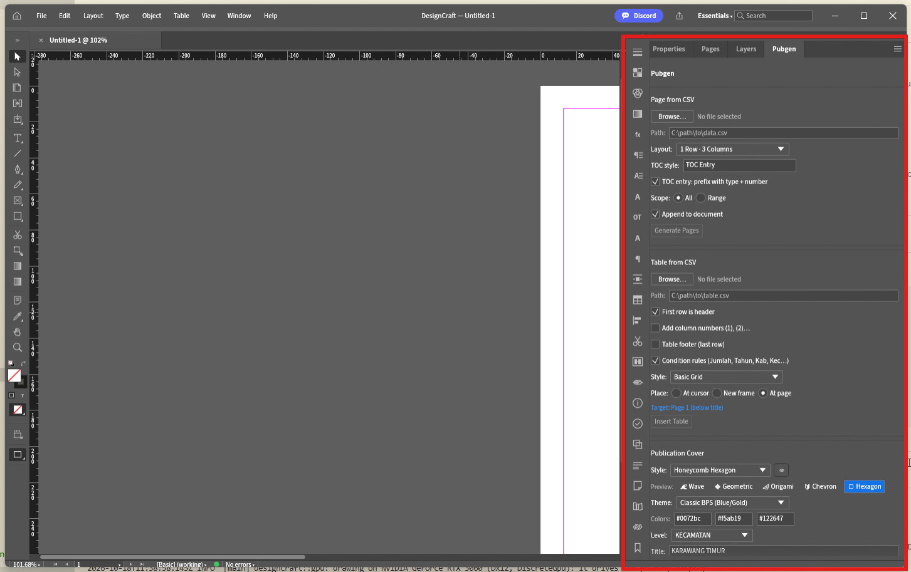
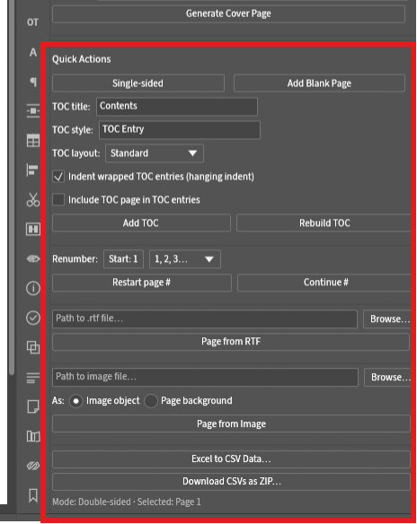

# Pubgen: Generator Publikasi Otomatis — Panduan Lengkap Pengguna

> **Selamat datang di Pubgen!** Panduan ini disusun khusus untuk penyusun publikasi, staf statistik, desainer tata letak, dan pengelola dokumen kelembagaan (seperti BPS dan instansi pemerintah/swasta). Seluruh fitur, opsi, dan alur kerja di dalam panel **Pubgen** dijelaskan secara rinci dengan bahasa yang mudah dipahami oleh pengguna umum.

---

## Daftar Isi
1. [Apa itu Pubgen?](#1-apa-itu-pubgen)
2. [Menemukan Panel Pubgen di DesignCraft](#2-menemukan-panel-pubgen-di-designcraft)
3. [Bagian 1: Publication Cover (Pembuat Halaman Sampul Otomatis)](#3-bagian-1-publication-cover-pembuat-halaman-sampul-otomatis)
   - [Ikhtisar & Posisi Halaman](#ikhtisar--posisi-halaman)
   - [5 Gaya Sampul Eksekutif](#5-gaya-sampul-eksekutif)
   - [Pratinjau Thumbnail Hover](#pratinjau-thumbnail-hover)
   - [Tema Warna & Kustomisasi Palet](#tema-warna--kustomisasi-palet)
   - [Metadata & Isian Informasi Publikasi](#metadata--isian-informasi-publikasi)
   - [Pemilih Gambar Kustom & Logo](#pemilih-gambar-kustom--logo)
   - [Membuat Halaman Sampul](#membuat-halaman-sampul)
4. [Bagian 2: Page from CSV / Excel (Otomasi Pembuatan Halaman & Bab)](#4-bagian-2-page-from-csv--excel-otomasi-pembuatan-halaman--bab)
   - [Cara Kerja](#cara-kerja)
   - [Format Berkas Input (CSV & Excel)](#format-berkas-input-csv--excel)
   - [Pemetaan Kolom (Type, Number, Title)](#pemetaan-kolom-type-number-title)
   - [Preset Tata Letak (Layout Presets)](#preset-tata-letak-layout-presets)
   - [Cakupan Data & Penempatan Halaman](#cakupan-data--penempatan-halaman)
   - [Menyisipkan Tabel Otomatis dari Kolom 'file'](#menyisipkan-tabel-otomatis-dari-kolom-file)
5. [Bagian 3: Table from CSV / Excel (Pembuat Tabel Statistik Siap Cetak)](#5-bagian-3-table-from-csv--excel-pembuat-tabel-statistik-siap-cetak)
   - [Cara Kerja](#cara-kerja-1)
   - [Opsi Header & Header Bertingkat (Stacked Headers)](#opsi-header--header-bertingkat-stacked-headers)
   - [Baris Nomor Kolom: (1), (2), (3)...](#baris-nomor-kolom-1-2-3)
   - [Baris Footer Tabel & Catatan Sumber Otomatis](#baris-footer-tabel--catatan-sumber-otomatis)
   - [Aturan Kondisi (Condition Rules: Penyorotan Otomatis Baris Jumlah/Total)](#aturan-kondisi-condition-rules-penyorotan-otomatis-baris-jumlahtotal)
   - [Gaya Garis Tabel (Booktabs Horizontal, Navy, Grid)](#gaya-garis-tabel)
   - [Mode Penempatan Tabel (At Page, New Frame, At Cursor)](#mode-penempatan-tabel)
   - [Berkas Excel Multi-Sheet & Ekspor Arsip ZIP](#berkas-excel-multi-sheet--ekspor-arsip-zip)
6. [Bagian 4: Quick Actions & Alat Bantu Editorial](#6-bagian-4-quick-actions--alat-bantu-editorial)
   - [Sakelar Halaman Tunggal vs Halaman Ganda (Facing Pages)](#sakelar-halaman-tunggal-vs-halaman-ganda-facing-pages)
   - [Menambah Halaman Kosong (Add Blank Page)](#menambah-halaman-kosong-add-blank-page)
   - [Daftar Isi Otomatis (Add TOC / Rebuild TOC)](#daftar-isi-otomatis-add-toc--rebuild-toc)
   - [Impor Cerita Teks RTF (Page from RTF)](#impor-cerita-teks-rtf-page-from-rtf)
   - [Menyisipkan Gambar (Page from Image: Objek vs Latar Belakang Penuh)](#menyisipkan-gambar-page-from-image-objek-vs-latar-belakang-penuh)
   - [Penomoran Ulang Halaman & Seksi (Romawi vs Arab)](#penomoran-ulang-halaman--seksi-romawi-vs-arab)
7. [Tutorial Praktis Langkah demi Langkah](#7-tutorial-praktis-langkah-demi-langkah)
   - [Tutorial 1: Menyusun Publikasi Lengkap dalam 3 Menit](#tutorial-1-menyusun-publikasi-lengkap-dalam-3-menit)
   - [Tutorial 2: Mendesain Sampul Kustom dengan Foto & Warna Sendiri](#tutorial-2-mendesain-sampul-kustom-dengan-foto--warna-sendiri)
   - [Tutorial 3: Memformat Tabel Statistik Kompleks dari Excel](#tutorial-3-memformat-tabel-statistik-kompleks-dari-excel)
8. [Tanya Jawab (FAQ) & Panduan Mengatasi Kendala](#8-tanya-jawab-faq--panduan-mengatasi-kendala)

---

## 1. Apa itu Pubgen?

**Pubgen** (*Publication Generator*) adalah modul otomasi tata letak yang terpasang langsung di dalam DesignCraft.

Dalam aplikasi tata letak konvensional (seperti Adobe InDesign atau QuarkXPress), pembuatan publikasi statistik setebal ratusan halaman (seperti buku *Kecamatan Dalam Angka*, *Kabupaten Dalam Angka*, atau Laporan Tahunan) menuntut ratusan langkah manual yang memakan waktu: menggambar kotak teks satu per satu, mengatur gaya judul, merapikan batas tabel, memasukkan logo, dan menyusun titik-titik daftar isi.

Pubgen mengotomatiskan seluruh alur kerja tersebut:
- **Sampul Instan**: Membangun sampul korporat eksekutif lengkap dengan geometri modern, bayangan lembut, foto terpotong rapi, dan tipografi resmi.
- **Halaman Otomatis**: Membaca daftar bab atau tabel dari Excel/CSV dan menyusun puluhan halaman rapi dalam hitungan detik.
- **Tabel Standar Penerbitan**: Memformat tabel data mengikuti standar baku BPS (garis horizontal tipis-tebal *booktabs*, header bertingkat, penomoran kolom resmi, serta penyorotan baris Jumlah/Total secara otomatis).
- **Alat Editorial Praktis**: Memudahkan pengelolaan halaman bolak-balik (ganda), penomoran angka Romawi dan Arab, pengaliran teks dokumen RTF, serta peremajaan Daftar Isi secara dinamis.

---

## 2. Menemukan Panel Pubgen di DesignCraft

Di layar utama DesignCraft, perhatikan panel bilah sisi kanan (**Right Dock**):

Klik tab **Pubgen**. Anda akan melihat 4 kartu menu utama:
1. **Publication Cover** (Sampul Publikasi)
2. **Page from CSV** (Halaman dari CSV / Excel)
3. **Table from CSV** (Tabel dari CSV / Excel)
4. **Quick Actions** (Aksi Cepat & Alat Bantu Editorial)

Anda dapat mengklik tanda panah `▼` di sebelah setiap judul kartu untuk membuka atau menutup menu tersebut.

---

## 3. Bagian 1: Publication Cover (Pembuat Halaman Sampul Otomatis)

Menu **Publication Cover** memungkinkan Anda membuat halaman sampul depan buku/laporan berstandar eksekutif dengan satu kali klik.

### Ikhtisar & Posisi Halaman
- **Selalu Menjadi Halaman Depan**: Saat tombol **Generate Cover Page** diklik, Pubgen secara otomatis menyisipkan halaman baru persis sebelum Halaman 1 dan mengarahkan tampilan kanvas ke sampul tersebut. Halaman isi yang sudah ada sebelumnya tidak akan rusak atau bergeser keliru.
- **Skala Otomatis yang Presisi**: Baik dokumen Anda berukuran **A4**, **A5**, maupun **B5**, seluruh elemen vektor, bentuk poligon, jarak bingkai, dan ukuran huruf akan disesuaikan secara proporsional.

---

### 5 Gaya Sampul Eksekutif

Pubgen menyediakan 5 pilihan desain sampul siap pakai:

#### 1. Wave Curves (`🌊 Wave`)
- **Karakter Visual**: Mengalir dinamis, modern, dan luwes.
- **Elemen Desain**:
  - Dua lengkungan gelombang besar asimetris (gelombang bawah biru tua elegan dan gelombang atas putih bersih).
  - Garis kurva konsentris berwarna emas (*amber gold*).
  - Bingkai medali bulat di tengah untuk menempatkan foto pemandangan kota/daerah.
  - Penempatan blok judul dan nomor katalog yang tegas dan kontras.
- **Paling Cocok Untuk**: Laporan statistik sosial, profil daerah, lingkungan hidup, dan publikasi umum.

#### 2. Geometric Medallion (`❖ Medallion`)
- **Karakter Visual**: Kokoh, arsitektural, dan terstruktur.
- **Elemen Desain**:
  - Bidang pembagi diagonal bersudut tegas.
  - Potongan foto berbentuk lingkaran dengan cincin ganda emas dan biru gelap serta bayangan lembut (*ambient drop shadow*).
  - Pita aksen diagonal di bagian atas dan bawah.
- **Paling Cocok Untuk**: Sensus ekonomi, statistik industri, tata kota, dan laporan tahunan institusi.

#### 3. Folded Origami (`◈ Origami`)
- **Karakter Visual**: Futuristik, berdimensi faset lipatan kertas (*low-poly*), dan dinamis.
- **Elemen Desain**:
  - Poligon geometris bersudut dengan pencahayaan faset lipatan origami.
  - Foto panorama lanskap lebar yang terpasang di separuh atas halaman sampul.
  - Potongan faset emas dan biru tua di bagian kiri bawah yang menciptakan kesan arah maju.
  - Blok tipografi judul yang berani dan kontras.
- **Paling Cocok Untuk**: Publikasi perdagangan, data transportasi, inovasi daerah, dan direktori bisnis.

#### 4. Chevron & Medallion (`◆ Chevron`)
- **Karakter Visual**: Berwibawa, klasik, dan mencerminkan kelembagaan resmi.
- **Elemen Desain**:
  - Latar belakang kanvas putih bersih yang sangat elegan.
  - Pita panah (*chevron*) biru safir besar mengarah ke bawah, membingkai judul utama publikasi.
  - Medali bulat besar berisi foto lanskap kota yang dilingkari cincin emas.
  - Angka tahun raksasa (`2026`) menggunakan font **Arial Black** tepat di titik fokus medali.
  - Bilah branding instansi di bagian bawah dengan lambang resmi.
- **Paling Cocok Untuk**: Publikasi resmi pemerintah, buku rujukan statistik utama, dan edisi khusus.

#### 5. Honeycomb Hexagon (`⬡ Hexagon`)
- **Karakter Visual**: Premium, korporat, berkelas tinggi, dan mutakhir.
- **Elemen Desain**:
  - Latar belakang biru malam pekat (*Midnight Slate / Navy* `#111827`) yang memberikan kedalaman visual yang mewah.
  - Tiga garis vertikal arsitektural di sisi kanan dengan warna emas bertingkat (*opacity 85%*, *60%*, *35%*).
  - Pita panah biru safir horizontal di sisi kiri yang diberi garis aksen emas di bawahnya.
  - **Klaster Bingkai Honeycomb 12-Sudut**: Poligon tiga segi enam (*tri-hexagon*) yang menyatu, diberi bingkai tepi putih tebal 10pt, bayangan lembut, memotong foto lanskap secara presisi, serta dihiasi garis kontur emas di dalamnya.
  - Angka tahun 60pt tebal (**Arial Black**) di kiri bawah dengan garis tebal emas.
- **Paling Cocok Untuk**: Publikasi unggulan (*flagship*), rilis tahunan bergengsi, dan ringkasan eksekutif.

---

### Pratinjau Thumbnail Hover
- Di bawah menu pilihan gaya, terdapat tombol pil cepat: `🌊 Wave`, `❖ Medallion`, `◈ Origami`, `◆ Chevron`, `⬡ Hexagon`.
- Cukup **arahkan kursor tetikus (hover)** ke salah satu pil (atau klik ikon mata `👁` di samping menu). Jendela melayang (*tooltip*) akan langsung menampilkan thumbnail foto sampul yang sesungguhnya beresolusi tinggi, sehingga Anda dapat memilih desain dengan yakin sebelum membuatnya.

---

### Tema Warna & Kustomisasi Palet
Anda dapat memilih tema baku atau memasukkan kode warna heksadesimal sendiri:
- **Primary Color** (Warna Utama, bawaan: `#0072bc` / Biru Safir): Untuk pita judul utama, panah chevron, dan elemen bidang dominan.
- **Accent Color** (Warna Aksen, bawaan: `#f5ab19` / Emas Amber): Untuk garis sorotan, cincin medali, label kategori, dan garis bawah angka tahun.
- **Dark Color** (Warna Gelap, bawaan: `#111827` / Biru Malam): Untuk latar belakang kanvas gelap dan teks berbobot kuat.

---

### Metadata & Isian Informasi Publikasi
Lengkapi data publikasi Anda:
- **Level**: Pilih **Kecamatan** atau **Kabupaten**. Kata pengantar di atas judul akan menyesuaikan secara otomatis.
- **Title**: Masukkan nama wilayah atau topik publikasi (contoh: `KARAWANG TIMUR`). Pubgen akan memformat teks ini dengan font **Arial Black** dan menambahkan teks `DALAM ANGKA`.
- **Year**: Masukkan tahun publikasi (contoh: `2026`). Ditampilkan menonjol dengan font tebal **Arial Black**.
- **Volume**: Masukkan nomor edisi/volume (contoh: `Volume 23 2026`).
- **Catalog BPS**: Masukkan nomor katalog resmi (contoh: `1102001.3215113`). Pubgen otomatis menambahkan awalan `Katalog BPS:` jika Anda belum mengetikkannya.
- **Kode Terbitan**: Pilih **ISSN** atau **ISBN** lalu ketikkan nomor serinya (contoh: `2828-7436`).
- **Teks Instansi**: Masukkan nama institusi (contoh: `BADAN PUSAT STATISTIK\nKABUPATEN KARAWANG`). Diformat rapi menggunakan **Arial Bold Italic**. Gunakan `\n` untuk memisahkan baris nama instansi dan nama daerah.

---

### Pemilih Gambar Kustom & Logo
Pubgen secara otomatis menampilkan kotak pemilih gambar yang relevan dengan gaya yang sedang aktif:
- **Skyline Image**: Untuk sampul bergaya *Wave Curves* dan *Chevron & Medallion*.
- **Landscape Image**: Untuk sampul bergaya *Folded Origami* dan *Geometric Medallion*.
- **Honeycomb Image**: Untuk sampul bergaya *Honeycomb Hexagon*. Foto Anda akan otomatis dipotong rapi mengikuti bentuk segi enam bersarang (*tri-hexagon*).
- **Logo**: Klik tombol **Browse...** untuk memilih berkas logo instansi (format `.png`, `.jpg`, atau `.webp`). Logo akan disematkan secara proporsional tanpa gepeng/terdistorsi.

---

### Membuat Halaman Sampul
Setelah semua kolom terisi, klik tombol biru:
👉 **[ Generate Cover Page ]**

Hanya dalam sekejap (kurang dari 0,1 detik):
1. Halaman sampul baru disisipkan di posisi paling awal buku Anda.
2. Vektor bentuk, poligon, bayangan, dan garis batas dibuat secara presisi.
3. Foto pemandangan dan logo diposisikan dan dipotong rapi.
4. Teks judul, nomor katalog, dan identitas instansi dirender menggunakan hierarki tipografi resmi (**Arial Black**, **Arial Bold**, **Arial Bold Italic**).
5. Layar kanvas otomatis berpindah ke halaman sampul yang baru selesai dibuat.

---

## 4. Bagian 2: Page from CSV / Excel (Otomasi Pembuatan Halaman & Bab)

Jika Anda memiliki daftar isi atau matriks katalog publikasi di Excel atau CSV, alat ini akan membuatkan puluhan hingga ratusan halaman isi lengkap dengan judulnya secara otomatis.

### Cara Kerja
Daripada menambah halaman baru secara manual satu demi satu lalu mengetik "Tabel 1.1.1 Luas Wilayah Menurut Desa...", Pubgen membaca data tabel Anda dan menghasilkan halaman-halaman tersebut secara instan.

### Format Berkas Input (CSV & Excel)
- Klik **Browse...** untuk memilih berkas `.csv`, `.tsv`, atau `.xlsx` (Excel).
- **Deteksi Pemisah Otomatis**: Pubgen secara cerdas mengenali apakah berkas Anda menggunakan koma (`,`), titik koma (`;`, format umum pada sistem operasi Indonesia), atau tab.

### Pemetaan Kolom (Type, Number, Title)
Pubgen membutuhkan tiga informasi pokok dari setiap baris data:
1. **Type (Tipe/Kategori)**: Tingkatan atau jenis judul (contoh: `Tabel`, `BAB`, `Grafik`, `Subbab`).
2. **Number (Nomor)**: Penomoran atau kode judul (contoh: `1.1.1`, `BAB I`, `Grafik 2.1`).
3. **Title (Judul)**: Teks deskripsi isi halaman (contoh: `Luas Wilayah Menurut Desa/Kelurahan`).

Jika berkas Anda memiliki nama kolom seperti `type`, `number`, `title` (atau `kategori`, `nomor`, `judul`), Pubgen akan memilihnya secara otomatis. Anda juga dapat mengubah dropdown pemetaan secara manual.

### Preset Tata Letak (Layout Presets)
Tentukan bagaimana bagian kepala (*header*) halaman disusun:
- **1 Row · 3 Columns (Standar Publikasi BPS - Disarankan)**:
  - Menyusun judul menjadi 1 baris horizontal rapi:
    `Tabel` (kiri) | `1.1.1` (tengah) | `Luas Wilayah Menurut Desa...` (kanan).
  - Lebar kolom disesuaikan secara otomatis dengan panjang teks sehingga tidak ada rongga kosong yang janggal.
- **Editorial Chapter (Stacked)**:
  - Menyusun kategori di atas, angka bab besar di tengah, dan judul panjang di bawah. Sangat cocok untuk halaman pembatas bab (contoh: *BAB 1 GEOGRAFI*).
- **Technical Spec Card & Minimal Zine**:
  - Tata letak alternatif bergaya kartu teknis atau minimalis modern.

### Cakupan Data & Penempatan Halaman
- **All records**: Memproses seluruh baris data dari awal hingga akhir.
- **Range (contoh: 1-10)**: Hanya memproses baris tertentu saja.
- **Append to document**: Menambahkan halaman-halaman baru ke bagian paling belakang buku. Hapus centang jika ingin menyisipkan halaman persis setelah halaman yang sedang aktif.

### Menyisipkan Tabel Otomatis dari Kolom 'file'
Jika berkas katalog CSV Anda memiliki kolom ke-4 bernama `file` yang berisi nama berkas tabel (contoh: `01_01.csv`, `01_02.csv`), centang opsi:
`[x] Auto-insert table from 'file' col`
Maka Pubgen akan **sekaligus membuat halamannya DAN memasang tabel data statistik yang terformat rapi persis di bawah judul halaman** dalam satu proses!

---

## 5. Bagian 3: Table from CSV / Excel (Pembuat Tabel Statistik Siap Cetak)

Tabel statistik kelembagaan menuntut ketelitian tinggi: batas garis yang rapi, penomoran kolom resmi, serta penegasan pada baris total. Pubgen mengubah data angka mentah menjadi tabel vektor asli yang siap cetak.

### Cara Kerja
Pilih berkas CSV atau lembar kerja Excel, tentukan gaya garis yang diinginkan, lalu klik **Insert Table**. Tabel akan langsung terpasang di dokumen dan dapat diedit secara penuh layaknya tabel buatan tangan.

---

### Opsi Header & Header Bertingkat (Stacked Headers)

#### Baris pertama sebagai header (First row is header)
Centang opsi ini jika baris pertama data Anda berisi nama-nama kolom. Teks akan otomatis ditebalkan (*bold*) dan baris dikunci sebagai kepala tabel.

#### Header Bertingkat Otomatis (`Induk--Anak`)
Pada publikasi statistik, kolom sering kali dikelompokkan di bawah satu payung kategori (contoh: kolom *Laki-Laki* dan *Perempuan* yang berada di bawah kelompok *Jenis Kelamin*).
- Di berkas Excel atau CSV Anda, cukup tuliskan nama kolom dengan tanda strip ganda (`--`):
  `Jenis Kelamin--Laki-Laki`
  `Jenis Kelamin--Perempuan`
  `Jumlah`
- Pubgen secara otomatis membaca tanda strip ganda tersebut dan membuat **kepala tabel bertingkat** (hingga 3 tingkat):
  - Kolom induk (*Jenis Kelamin*) otomatis **menggabungkan sel secara horizontal** (*merge horizontal*) menaungi anak-anaknya.
  - Kolom tunggal (*Jumlah*) otomatis **menggabungkan sel ke bawah** (*merge vertical*) sehingga tampilan kepala tabel tetap simetris dan rapi.

---

### Baris Nomor Kolom: (1), (2), (3)...
Standar baku publikasi BPS mewajibkan adanya baris penomoran kolom di bawah kepala tabel.
- Centang opsi **`[x] Add column numbers (1), (2)...`**.
- Pubgen akan menyisipkan satu baris khusus tepat di bawah judul kolom dengan nomor `(1)`, `(2)`, `(3)`... di tengah-tengah setiap kolom, dibatasi garis tipis 0,5pt.

---

### Baris Footer Tabel & Catatan Sumber Otomatis

#### Table footer (baris terakhir sebagai footer)
Centang opsi ini jika baris terakhir tabel Anda adalah baris rekapitulasi atau total. Baris ini akan diberi garis pembatas atas 0,5pt dan garis penutup bawah 1,0pt.

#### Deteksi Otomatis Catatan Kaki / Sumber Data
Jika baris terakhir dari data CSV Anda berisi keterangan sumber (contoh: `Sumber: Dinas Kependudukan dan Pencatatan Sipil`):
- Pubgen secara cerdas mengetahui bahwa hanya kolom pertama yang berisi teks sementara kolom lainnya kosong.
- Teks sumber tersebut otomatis dikeluarkan dari kisi tabel agar lebar kolom angka tidak rusak.
- Pubgen membuatkan kotak teks terpisah khusus keterangan sumber di bawah tabel dengan format cetak miring (*italic*).

---

### Aturan Kondisi (Condition Rules: Penyorotan Otomatis Baris Jumlah/Total)
Dalam lembar data angka, baris ringkasan wajib terlihat menonjol.
- Centang opsi **`[x] Condition rules (Jumlah, Tahun, Kab, Kec...)`**.
- Pubgen akan memindai kolom pertama dari setiap baris data tabel.
- Setiap kali menemukan kata kunci seperti `Jumlah`, `Total`, `Tahun`, `Kabupaten`, atau `Kecamatan`:
  - Baris tersebut otomatis diberi garis pembatas atas dan bawah sebesar 0,5pt.
  - Teks pada baris tersebut otomatis ditebalkan (*bold*).
  - Subtotal per wilayah maupun total akhir otomatis tampil rapi dan tegas.

---

### Gaya Garis Tabel
- **Horizontal Rules (Standar Booktabs - Sangat Disarankan)**:
  Format baku ilmiah dan publikasi statistik internasional:
  - Garis penutup atas tebal 1,0pt.
  - Garis pembatas header tipis 0,5pt.
  - Garis pembatas nomor kolom 0,5pt.
  - **Tanpa garis vertikal** (tampilan data bersih, mudah dibaca, dan tidak melelahkan mata).
  - Garis penutup bawah tebal 1,0pt.
- **Corporate Navy**:
  - Baris header berwarna biru gelap dengan teks putih.
  - Baris data selang-seling abu-abu muda (*zebra-striping*) untuk memudahkan pembacaan tabel yang sangat lebar.
- **Basic Grid**:
  - Garis kotak penuh di setiap batas sel tabel.

---

### Mode Penempatan Tabel
- **At page (Disarankan)**: Secara otomatis menargetkan halaman yang sedang Anda pilih di panel **Pages**, mendeteksi batas bawah judul halaman, lalu menempatkan tabel tepat di bawah judul dengan jarak aman 20pt.
- **New frame**: Menempatkan tabel di tengah halaman mulai dari batas margin atas.
- **At cursor**: Menyisipkan tabel langsung di dalam kotak teks yang sedang aktif kursornya.

---

### Berkas Excel Multi-Sheet & Ekspor Arsip ZIP
Jika Anda membuka berkas Excel yang memiliki banyak lembar (*multi-sheet* `.xlsx`):
- Pubgen membaca seluruh lembar kerja di dalam berkas tersebut.
- Muncul menu dropdown **Sheet table**: Anda dapat berpindah antar-lembar tabel (*Tabel 1.1*, *Tabel 1.2*, dst.) cukup dengan satu klik.
- **Download CSVs as ZIP...**: Tombol ini memungkinkan Anda mengunduh seluruh lembar tabel hasil konversi dalam bentuk arsip `.zip` yang tersimpan rapi di komputer Anda.

---

## 6. Bagian 4: Quick Actions & Alat Bantu Editorial

Bagian **Quick Actions** menyediakan berbagai tombol pintas untuk mempercepat perapian naskah buku:

### Sakelar Halaman Tunggal vs Halaman Ganda (Facing Pages)
- **Halaman Ganda (Double-sided / Facing Pages)**: Format wajib untuk buku cetak, di mana halaman kiri (*verso*) dan kanan (*recto*) berhadapan dengan margin cermin (ada ruang jilid di bagian dalam).
- **Halaman Tunggal (Single-sided)**: Untuk dokumen digital PDF yang dibaca di layar monitor atau tablet.
- Klik tombol sakelar untuk berganti mode kapan saja secara aman tanpa merusak posisi teks.

---

### Menambah Halaman Kosong (Add Blank Page)
Dalam aturan tata letak buku formal, setiap bab baru sebaiknya selalu dimulai di halaman sebelah kanan (halaman ganjil / *recto*).
- Jika bab sebelumnya berakhir di halaman kanan, klik **Add Blank Page** untuk menyisipkan satu halaman kosong sebagai penyeimbang sebelum bab baru dimulai.

---

### Daftar Isi Otomatis (Add TOC / Rebuild TOC)
Pubgen dapat memindai seluruh judul halaman di dokumen Anda dan menyusun Daftar Isi lengkap dengan titik-titik penuntun (*leader dots*) secara otomatis.

#### Pilihan Tata Letak Daftar Isi:
1. **Standard Layout**:
   - Format umum buku teks:
     `Tabel 1.1 Luas Wilayah Menurut Desa ........................... 12`
2. **TablePage Layout (Standar Katalog Statistik BPS)**:
   - Diformat khusus mengikuti standar rujukan buku BPS:
     - Judul kolom kiri: `Tabel`
     - Judul kolom kanan: `Halaman`
     - Nomor tabel terpisah rapi: `1.1`
     - Teks judul tabel berinden menggantung (*hanging indent*) agar baris kedua tidak bertumpuk di bawah nomor tabel.
     - Nama bab ditulis tebal (*bold*) tanpa nomor halaman.
     - **Header Berulang Otomatis**: Jika Daftar Isi memanjang lebih dari satu halaman, tulisan `Tabel` dan `Halaman` akan otomatis diulang di bagian paling atas halaman berikutnya!

#### Memperbarui Daftar Isi (Rebuild TOC)
Jika di kemudian hari Anda menambah, menghapus, atau menukar posisi halaman, cukup klik **Rebuild TOC**. Pubgen akan memindai ulang seluruh dokumen dan memperbarui nomor halaman di Daftar Isi secara otomatis.

---

### Impor Cerita Teks RTF (Page from RTF)
Untuk memasukkan naskah teks panjang seperti *Kata Pengantar*, *Undang-Undang Statistik*, atau *Ringkasan Eksekutif*:
1. Simpan naskah Word Anda ke dalam format Rich Text Format (`.rtf`).
2. Klik **Browse...** lalu pilih berkas `.rtf` tersebut.
3. Klik **Insert RTF Story**.
4. Pubgen akan mengalirkan teks secara otomatis mengikuti batas margin halaman. Jika teks terlalu panjang, Pubgen **secara otomatis membuatkan halaman-halaman baru dan menyambungkan kotak teksnya** hingga seluruh naskah selesai tertampung. Huruf tebal, miring, ukuran font, dan poin balet tetap terjaga rapi.

---

### Menyisipkan Gambar (Page from Image: Objek vs Latar Belakang Penuh)
Memudahkan penempatan foto infografis atau halaman pemisah bab (*Pembatas BAB*):
- **Page margins (Object)**: Menyesuaikan ukuran foto agar pas di dalam batas margin halaman.
- **Page background**: Memperbesar foto hingga memenuhi seluruh bidang kertas (*full-bleed*), memposisikannya di tengah, lalu memindahkannya ke lapisan paling belakang. Sangat cocok untuk halaman pemisah bab yang berlatar gambar penuh.

---

### Penomoran Ulang Halaman & Seksi (Romawi vs Arab)
Buku resmi umumnya terbagi menjadi dua bagian penomoran:
1. **Bagian Awal / Halaman Pendahuluan** (Kata Pengantar, Daftar Isi): Menggunakan angka Romawi kecil (`i, ii, iii...`).
2. **Bagian Isi / Bab Utama** (Mulai dari Bab 1 hingga selesai): Menggunakan angka Arab biasa (`1, 2, 3...`).

#### Cara Penggunaan:
1. Buka halaman Kata Pengantar atau Daftar Isi Anda.
2. Di menu **Page Renumbering**, pilih **Style: Roman (i, ii, iii...)**, Start #: `1`. Klik **Restart page #**.
3. Buka Halaman 1 dari Bab pertama Anda.
4. Pilih **Style: Arabic (1, 2, 3...)**, Start #: `1`. Klik **Restart page #**.
5. Klik **Rebuild TOC**: Seluruh angka halaman di Daftar Isi otomatis diperbarui mengikuti skema penomoran Romawi untuk halaman awal dan Arab untuk halaman isi!

---

## 7. Tutorial Praktis Langkah demi Langkah

### Tutorial 1: Menyusun Publikasi Lengkap dalam 3 Menit

Berikut alur kerja praktis menyusun publikasi statistik dari nol hingga selesai:

1. **Membuat Dokumen Baru**:
   - Tekan tombol pintas `Ctrl+N` (Menu `File` ▸ `New Document`). Pilih ukuran `A4`, centang *Facing Pages*.
2. **Membuat Sampul Depan**:
   - Buka panel **Pubgen** di bilah kanan.
   - Buka menu **Publication Cover**.
   - Pilih gaya **`⬡ Hexagon`** (atau arahkan kursor ke pil gaya untuk melihat pratinjau).
   - Isi judul: `KARAWANG TIMUR` dan tahun: `2026`.
   - Klik **Generate Cover Page**. Sampul langsung jadi di Halaman 1!
3. **Membuat Halaman Judul Bab**:
   - Buka menu **Page from CSV**.
   - Klik **Browse...** lalu pilih berkas contoh `samples/KBDA2026_chapters.csv`.
   - Pilih preset: `1 Row · 3 Columns`.
   - Klik **Generate Pages**. Sebanyak 28 halaman judul bab otomatis terbentuk!
4. **Memasukkan Tabel Data**:
   - Pindah ke Halaman 2 dokumen.
   - Buka menu **Table from CSV**.
   - Klik **Browse...** lalu pilih berkas `samples/kbda_2005.csv`.
   - Pilih gaya: `Horizontal Rules (Booktabs)`. Penempatan: `At page (below title)`.
   - Centang opsi `[x] Condition rules (Jumlah, Tahun, Kab, Kec...)`.
   - Klik **Insert Table**. Tabel statistik langsung terpasang rapi di bawah judul!
5. **Membuat Daftar Isi**:
   - Di menu **Quick Actions**, klik **Add Blank Page**.
   - Pada bagian Table of Contents, ketikkan Judul: `DAFTAR TABEL`, pilih Layout: `TablePage`.
   - Klik **Add TOC**. Daftar isi langsung tercipta lengkap dengan nomor halamannya!
6. **Mengekspor ke PDF**:
   - Buka menu utama `File` ▸ `Export` ▸ `PDF (Print)`. Publikasi Anda siap untuk dicetak atau disebarluaskan secara digital!

---

### Tutorial 2: Mendesain Sampul Kustom dengan Foto & Warna Sendiri

Ingin menyesuaikan sampul dengan identitas visual daerah Anda?

1. Pada kartu **Publication Cover**:
   - Pilih gaya sampul, misalnya **`❖ Medallion`** atau **`⬡ Hexagon`**.
2. **Menyesuaikan Warna**:
   - Masukkan kode warna resmi daerah Anda, misalnya:
     - Primary: `#1e3a8a` (Biru Laut)
     - Accent: `#10b981` (Hijau Zamrud)
     - Dark: `#0f172a` (Biru Gelap Arang)
3. **Memilih Foto Sendiri**:
   - Pada bagian **Cover Images**, klik tombol **Browse...** di samping *Landscape* atau *Honeycomb*.
   - Pilih foto pemandangan terbaik dari komputer Anda (format `.jpg` atau `.png`).
4. **Memasang Lambang Daerah / Logo**:
   - Klik **Browse...** pada kotak *Logo* lalu pilih berkas lambang daerah berlatar transparan.
   - Ketikkan identitas lembaga pada isian *Logo Text*.
5. Klik **Generate Cover Page**. Sampul eksklusif Anda langsung selesai!

---

### Tutorial 3: Memformat Tabel Statistik Kompleks dari Excel

Jika Anda memiliki tabel dengan kelompok kolom bersusun (misalnya: Jumlah Penduduk menurut Kelompok Umur dan Jenis Kelamin):

1. Pada lembar kerja Excel, beri nama kepala kolom menggunakan tanda hubung ganda (`--`):
   | Kecamatan | Usia 0-14--Laki-Laki | Usia 0-14--Perempuan | Usia 15-64--Laki-Laki | Usia 15-64--Perempuan | Total |
2. Simpan lembar kerja tersebut sebagai berkas `.xlsx` atau `.csv`.
3. Di DesignCraft, buka kartu **Table from CSV / Excel**:
   - Klik **Browse...** lalu pilih berkas Anda.
   - Centang `[x] First row is header`.
   - Centang `[x] Add column numbers (1), (2)...`.
   - Centang `[x] Table footer (last row)`.
   - Centang `[x] Condition rules (Jumlah, Tahun, Kab, Kec...)`.
   - Pilih gaya `Horizontal Rules (Booktabs)`.
4. Klik **Insert Table**.
5. Hasilnya: Tabel bertingkat rapi dengan penggabungan sel otomatis, baris penomoran kolom resmi `(1), (2), (3)...`, serta garis pembatas khusus pada baris total!

---

## 8. Tanya Jawab (FAQ) & Panduan Mengatasi Kendala

#### T: Berkas CSV saya menggunakan pemisah titik koma (;), bukan koma (,). Apakah bisa dibaca?
**J:** Tentu saja bisa! Pubgen dilengkapi dengan sensor pendeteksi otomatis yang mengenali titik koma (`;`), koma (`,`), maupun tab (`\t`). Anda tidak perlu mengubah pengaturan komputer Anda.

#### T: Mengapa Daftar Isi saya memunculkan tanda pagar (#) alih-alih nomor halaman?
**J:** Jika nomor halaman menampilkan tanda `#`, itu artinya kotak teks Daftar Isi ditaruh di Halaman Induk (*Master/Parent Page*). Pastikan Anda membuat Daftar Isi pada halaman dokumen biasa.

#### T: Apakah teks dan tabel yang dibuat oleh Pubgen masih bisa diedit secara manual?
**J:** Sangat bisa! Semua elemen yang dibuat oleh Pubgen—kotak teks, huruf, sel tabel, hingga garis vektor—adalah **objek asli DesignCraft**. Anda dapat mengklik dua kali pada teks untuk mengoreksi ketikan, mengubah lebar kolom dengan alat tabel (*Table Tool*), atau mengganti warna melalui panel *Swatches*.

#### T: Di mana berkas pengaturan dan riwayat kerja saya tersimpan jika menggunakan versi Portable?
**J:** Versi *Portable* menyertakan berkas penanda bernama `portable.txt`. Berkas ini memastikan seluruh konfigurasi, riwayat, dan pemulihan sistem tersimpan secara terisolasi di dalam folder lokal `DesignCraftData/` persis di samping berkas program `designcraft.exe`. Tidak ada data yang ditulis ke Windows Registry maupun folder `%APPDATA%`, sehingga komputer Anda tetap bersih.

#### T: Bagaimana cara menghasilkan berkas cetak beresolusi tinggi?
**J:** Buka menu utama `File` ▸ `Export` ▸ `PDF (Print)`. Anda dapat memilih standar cetak profesional (seperti PDF/X), menyematkan profil warna ICC, serta memilih resolusi gambar 300 DPI untuk kebutuhan percetakan offset komersial.

---

*DesignCraft Publication Generator (Pubgen) — Dirancang untuk Kecepatan, Keindahan, dan Ketepatan Tata Letak Statistik.*
